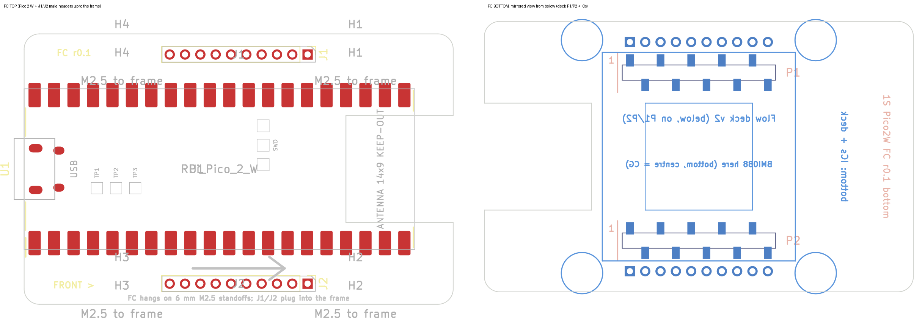
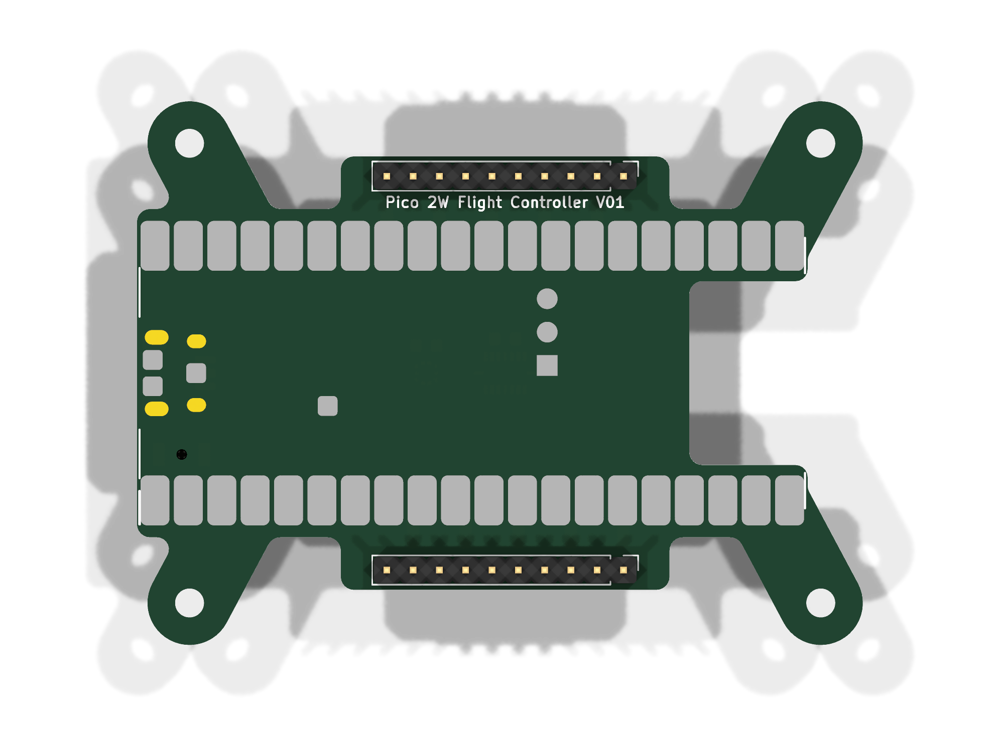
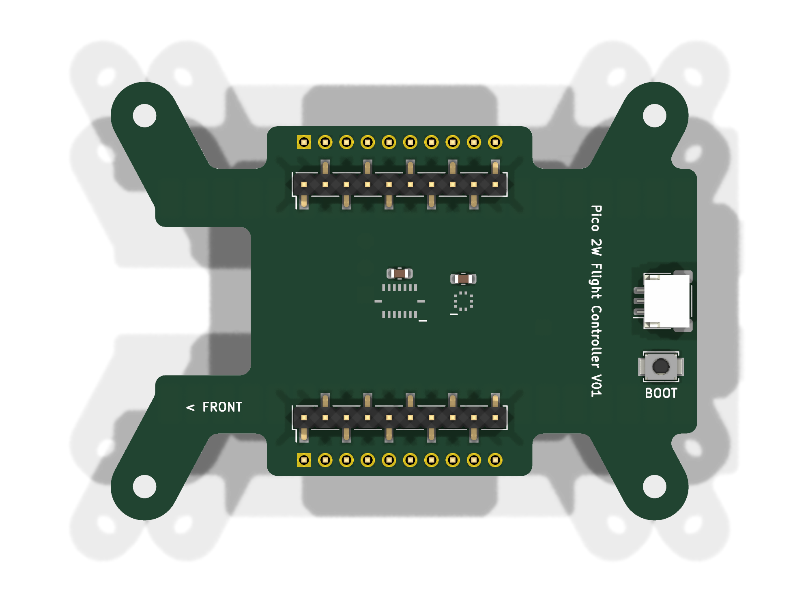
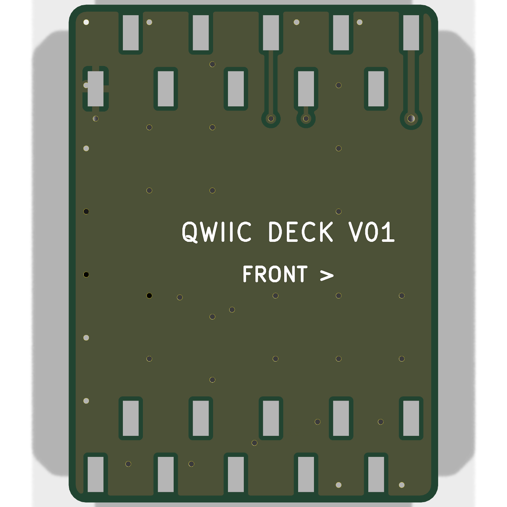
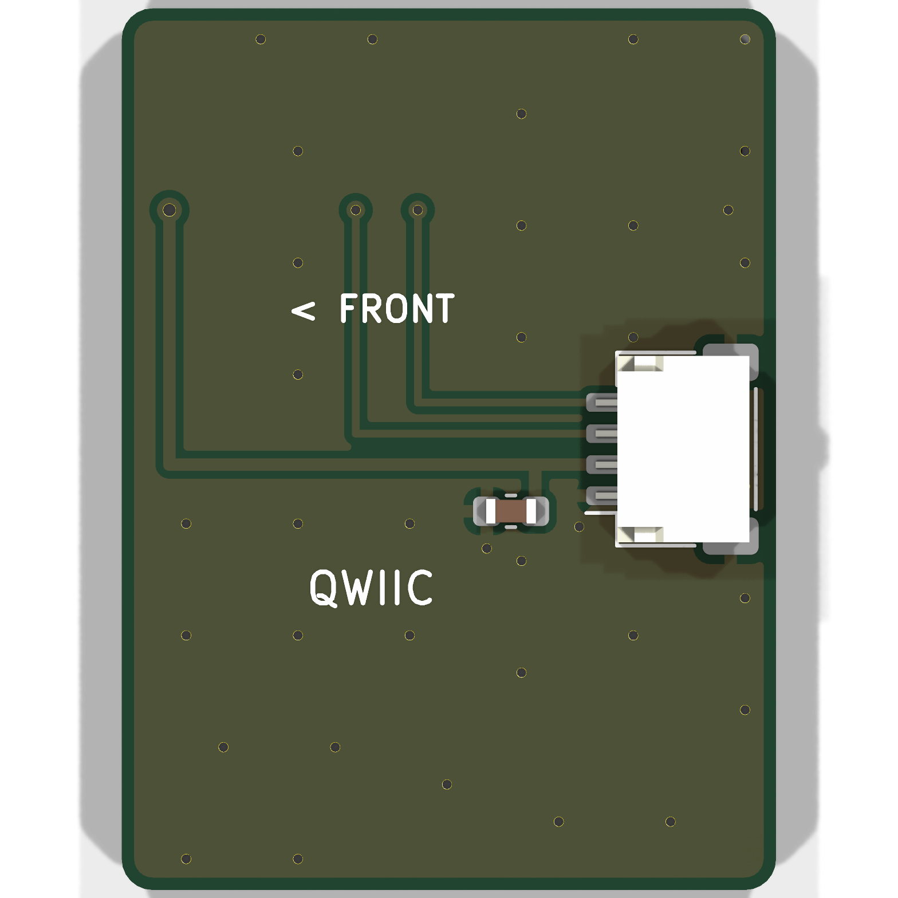

# Drone_1S_Pico2W: electronics for the 1S toothpick drone

Two boards for the 140 mm, single-18650 quad in
[OpenScad-Designs/Drones/1S_PiZero](https://github.com/arkadiraf/OpenScad-Designs/tree/main/Drones/1S_PiZero).
The flight controller is a **Raspberry Pi Pico 2 W** (RP2350 + CYW43439) on a new, custom module board.
It replaces the Crazyflie Bolt of the OpenSCAD design.

**The FC module leads the design and the frame follows it.** The OpenSCAD frame was drawn for the
Bolt, so the imported frame is only a mechanical baseline (outline, motor and ESC positions). Its
FC holes, connectors and wiring will be redone to suit the new FC and the 2 × 10 interface.

The design intent comes from
[Materials/Toothpick_Drone_Hardware_Design_1S_Pico_2_W.pdf](Materials/Toothpick_Drone_Hardware_Design_1S_Pico_2_W.pdf)
(2026-11-25). Its text is in `Materials/extracted/design_doc.txt`.

| Board | Folder | Size | Thickness | Carries |
|---|---|---|---|---|
| **Frame** (power board) | [Frame/](Frame/) | 117 × 117 mm, the quad frame itself | **2.0 mm** | 18650 tab pads, USB-C + BQ25606 charger, TPS22810 Pico rail switch + SPDT slide switch, 4 × TPS22997 motor switches, TPS61235P 5.1 V boost (optional), 4 × DYS XSD7A ESCs on pin headers, Pi Zero 5.1 V output, 2 × 10 header to the FC |
| **FC** (flight controller module) | [FC/](FC/) | 55.3 × 41.5 mm bbox, minimum outline | 1.6 mm | **Top:** Pico 2 W only (castellated SMD, faces the frame). **Bottom:** BMI088 IMU (SPI0), BMP388 baro (I2C0), support ICs, and the Crazyflie deck connectors for the Flow deck v2 (SPI1 + I2C0), which plugs in from below as it does under a Crazyflie. Also JST-SH 4 to the Pi Zero and the 2 × 10 header to the frame |

## Status: stage 1, bare boards (V01; 28 Nov update: orderable B2B connectors, printed-spacer stack, B3U-1000PM-B)

**Design document (PDF, 27 Nov 2026):** [docs/Toothpick_Drone_Hardware_Design_1S_Pico2W.pdf](docs/Toothpick_Drone_Hardware_Design_1S_Pico2W.pdf),
exported from the shared design doc. It has the design status, renders, the parts list and the to-do list.
**Orderable BOM:** [fabrication/BOM.md](fabrication/BOM.md) and
[fabrication/BOM_DigiKey.csv](fabrication/BOM_DigiKey.csv) (upload to the Digi-Key BOM Manager; MPNs are not
yet checked for stock).
**FC order sheet:** [fabrication/BOM_FC.xlsx](fabrication/BOM_FC.xlsx), the flight-controller parts plus the frame's mating
sockets J5/J6, the FC standoffs and the SWD cable, for 5 modules (`export_bom.py`). Connector selection and the
options not taken: [Materials/connector_options/](Materials/connector_options/README.md).
**Stock parts** (0603 resistors and capacitors from the sample book, 0805 LEDs): [fabrication/BOM_stock.md](fabrication/BOM_stock.md)
(16 values, with E24 fallbacks for the E96 values); they are left out of the Digi-Key CSV.
**Frame BOM review** (shared libraries, PicoBalancer lessons, decisions of 28 Nov): [Materials/FRAME_BOM_REVIEW.md](Materials/FRAME_BOM_REVIEW.md).
**Still to source** (cables, standoffs, screws, inserts, Samtec parts): [fabrication/BOM_to_source.md](fabrication/BOM_to_source.md).

| Stage | Content | State |
|---|---|---|
| 1 | Outlines, holes, fixed pads, placement guides, design rules | **done** |
| 2 | Pin map and netlist: FC in `tools/fc_design.py`, 2 × 10 header pinout in `design.py` (shared by both boards) | **FC done** (frame: next) |
| 3 | Symbols/footprints, schematics | **FC done** (`FC/Drone_1S_FC.kicad_sch`, NETLIST OK); frame next |
| 3b | 3D review of components and placement (OpenSCAD) | in review (scad not yet updated for the 7 mm stack) |
| 4 | Routing, pours, DRC, fab outputs (see `../AGENTS.md`) | **FC done** (28 Nov 2026, see "FC routing" below); frame next |




Guides: **Dwgs.User** shows top-side parts (props, cell, Pi Zero, Pico). **Cmts.User** shows
bottom-side parts (FC module outline on the frame, Crazyflie deck rows on the FC). Edit them freely.
They don't go to the fab.

### Frame: imported from OpenSCAD

Source: `1S_PiZero.scad`, `part="pcb_outline"`, exported as `1S_PiZero_PCB_outline.dxf` (OpenScad-Designs
commit `115559d`). A copy is in `Materials/extracted/`. The committed DXF was checked against a fresh
OpenSCAD export of the same scad file: same 60 holes, same outline.

`tools/dxf_import.py` takes the largest contour as the outline (312 segments on Edge.Cuts). It fits every
other contour as a circle and snaps it to a known drill:

| Drill | Count | Became | Ref |
|---|---|---|---|
| 4.0 | 4 | motor shaft clearance, NPTH | H1–H4 (with the motor screws) |
| 2.2 | 16 | motor M2 screws, 9 mm PCD, NPTH | H1–H4 (`MotorMount_1203_M2_9mm`) |
| 2.2 | 4 | the shared M2 holes: battery cover + landing gear + FC standoffs, NPTH | H_CV1–4 |
| 1.0 | 28 | ESC header pins, **plated**, 1.7 mm pads | J1–J4: pads 1–4 inner row (power end), 5–7 outer row (motor phases) |
| 0.75 | 2 | JST-PH holes for the Pi 5.1 V connector (JST ePH drill) | J8 (`JST_PH_B2B-PH-K_1x02_P2.00mm_Vertical`), pads asserted on the holes |

Plus **BT1**, the two 3 × 10 mm battery tab pads on top copper at x = ±33.6 mm (from `pcb()` in the
scad). Polarity is not set yet.

`tools/check_import.py` checks every drilled hole in the board against the DXF (within 0.01 mm, same
drill) and checks the outline segment count. Result: `IMPORT OK`, 58 holes.

Motor and ESC names: FL, FR, RR, RL (x forward to the camera, y left). In KiCad the front points right.

### Board-to-board: plug-in FC on standoffs

The FC module sits **under the frame** (the frame top over the centre carries the 18650 and its
cover). It **plugs into the frame through male/female headers**. Nothing is soldered between the
boards, so the FC can be pulled off and replaced.

**The battery cover and the FC share four M2 holes** at (±24, ±17.5). The printed battery cover
also carries the Pi Zero 2 W posts. One M2 × 20 through-bolt per hole (decided 28 Nov 2026), top to bottom:

| Layer | Thickness | |
|---|---|---|
| M2 × 20 galvanized screw ([4project](https://www.4project.co.il/product/screw-m2x20mm-galvanized)), head on the cover boss | | through everything below |
| printed battery cover boss + rail | 4 mm | |
| frame PCB | 2.0 mm | H_CV1–4 |
| **3D-printed spacer**, OD 5 mm, hole 2.3 mm, PETG or ASA (not PLA: creep, softens ~55 °C) | **7.0 mm** | print 7.0–7.2 mm, never under 6.9 mm: the headers seat at 6.6 mm (up to ~6.85 mm at tolerance) |
| FC module | 1.6 mm | H1–H4 (ears) |
| M2 nylon-insert lock nut (DIN 985) | ~2.8 mm | 14.6 mm grip; about 2.6 mm of the screw left for the nut |

Removing the four nuts frees the FC; the cover is then held only by the bolt heads, so keep the drone upright
or take the cover off with it.

**The landing gear has its own four M2 holes** (H_LG1–4) at (±35, ±18.5), near the front and rear
ends of the centre plate and outside the cover rails, so it swaps without touching the cover or the
FC. It is two identical printed skids (front, rear). Each skid is a cross-beam with an M2 heat-set
insert boss and a leg at each end, held by M2 × 4 screws from the frame top. A one-piece frame would
run into the FC standoffs at y = ±17.5. The frame's old 30.5 mm FC holes are gone.

**Connector choice (V01, updated 28 Nov 2026): orderable 2.00 mm pair on 7 mm printed spacers.** Options and
datasheets: [Materials/connector_options/](Materials/connector_options/README.md).
* **What sets the height:** the Pico 2 W's micro-USB is its tallest part, **3.73 mm** above the FC
  (KiCad-RP-Pico 3D model; BOOTSEL 2.08 mm, everything else ≤ 1.68 mm), so the gap must be over ~4 mm.
  The connector pair sets it at 7.0 mm, 3.3 mm over the USB.
* The first V01 layout used the Bitcraze female deck socket on 5 mm standoffs; that socket is not sold as a part.

| Board | Ref | Side | Part | Height |
|---|---|---|---|---|
| Frame | J5 (left), J6 (right) | bottom | **Sullins NPPN101BFLD-RC** 1×10 2.00 mm SMD socket (`KD_Connectors:Sullins_NPPN101BFLD_1x10_P2.00mm_SMD`, drawing 10489 layout D: 0.90 × 2.0 mm pads, ±1.6 mm stagger), no holes. Nylon body: hand-solder after the frame's reflow, plugged onto the FC headers for alignment | 4.6 mm |
| FC | J1 (left, +y), J2 (right, −y) | top | **Würth 62001011121** 2.00 mm male header, through-hole (`PinHeader_1x10_P2.00mm_Vertical`, holes opened to Würth's 0.90 mm by `gen_pcb.py`), pin 4.0 mm above the plastic | 2.0 mm plastic |

* **Mated:** 2.0 + 4.6 = 6.6 mm seated (up to ~6.85 mm at the socket tolerance) on the 7.0 mm spacer: the
  pins go about 3.6 mm into the sockets, past the 2.5 mm contact point, with ~0.4 mm of air. Nothing passes
  through the frame.
* **Pin budget (`B2B_SIGNALS` in `design.py`), 20 pins:** 16 signals + VSYS + 3 × GND.
  * ON1–4, PG1–4, DSHOT1–4, BOOST_EN, CHG_PG, USB_DP, USB_DM.
  * No PI_STATUS: the Pi handshake runs over USB.
  * No SWD: it stays on the FC (J9).
  * Pins are assigned in stage 2.

**Connectors to the Pi Zero 2 W, on the frame top:**
* **J7, Pi USB:** JST-SH 4 **vertical** (BM04B-SRSS-TB, top entry; 28 Nov), at (8.9, −18.8) on the frame top: right under the Pi Zero's USB-data port, just outside its −y edge, so the lead goes straight up. Carries GND, USB D−, USB D+, GND. Four pins so
  it can't be confused with the 3-pin SWD connector.
  * The Pi is the Pico's USB host (`dtoverlay=dwc2,dr_mode=host`). It flashes the Pico with
    `picotool reboot -f -u` then `picotool load -x`, talks to it over USB serial, and runs the
    boot / shutdown handshake.
  * No VBUS: the Pico runs from VSYS, and VBUS would back-feed VSYS through the Pico's Schottky.
  * **Handshake, over USB only:**
    * enumeration = Pi up;
    * shutdown = a command over USB serial, then the USB link stopping (the Pi's USB stops at the
      end of shutdown, after the filesystems are read-only), plus a grace period and a timeout;
    * disable USB autosuspend on the Pi.
* **J8, Pi 5.1 V:** JST-PH 2 (B2B-PH-K vertical) on the scad's two PH holes. The holes are 0.75 mm,
  JST's drill as in the KiCad footprint.

### FC module

**Outline, the minimum that holds the Pico 2 W and the Flow deck** (`fc_outline_pts()` in `gen_pcb.py`,
built with KiCad's polygon engine). It is the union of:
* the **Pico band**: x −28…23, |y| ≤ 12.5 (the Pico's lands reach |y| 11.29);
* a **middle block**: |x| ≤ 12.5, |y| ≤ 16.5, for the deck connector pads (|y| ≤ 13.4) and the J1/J2
  header pads (|y| ≤ 15.7);
* **four ears**: r 3.2 mm round the shared holes, joined to the band.

The 14 × 9 mm antenna notch is subtracted and all corners are filleted 1 mm. Bounding box
55.3 × 41.5 mm.

**Sensors (the Crazyflie set, from Bitcraze's open designs).** The Crazyflie 2.1 / Bolt 1.1 use
exactly these sensors, so their open schematics (bitcraze/hardware, CC-BY-NC-SA 4.0) are the
reference circuits:
* **BMI088** on SPI (PS to GND), separate accel/gyro chip selects. INT1 → INT_ACC; INT2 and INT3 →
  INT_GYR. 100 nF decoupling, supply from a filtered analog rail (Bolt: LDO + 1 µH + 4.7 µF).
* **BMP390** on I2C (CSB and SDO to VDD, address 0x77), 100 nF. It replaces the obsolete BMP388: same pins and
  footprint (Bosch BST-BMP390-DS002).
* BMI088 pin 2 (NC) to GND, as Bosch's pin table says (BST-BMI088-DS001 rev 1.9).

**Placement**, on the FC bottom, in the cavity between the deck rows under the Flow deck:
* **U2 BMI088 at (0, 0):** the frame centre, near the CG and on the Flow deck axis. Its long side
  runs along x so the package axes line up with the drone's (axis remap in firmware).
* **U3 BMP388 at (−6, 0):** under the deck board, so it is sheltered from prop wash and light, as
  the design doc asks.
* **C1, C2:** 100 nF 0603 next to each (repository passives rule, see the root README).
* The parts are 1.0 mm (BMI088) and 0.75 mm (BMP388) tall, well under the 4.1 mm deck connector
  stack.
* The rear part of the Pico band (x −27…−12) stays free for support ICs (IMU supply filter, etc.).

Package sources (the Bosch site and distributors are blocked from this container, so the data was
cross-checked from open designs and STEP models):
* **BMI088:** 4.5 × 3.0 × 1.0 mm, from Bosch's STEP model (via bit-bots). LGA-16 pads 0.35 × 0.59 mm,
  identical in ArduPilot (HKUST NxtPX4v2) and bit-bots. Pin numbers confirmed by the Crazyflie Bolt
  1.1 schematic (see "Validation" below). The pad-1 corner still needs the Bosch drawing.
* **BMP388:** 2.0 × 2.0 × 0.75 mm, from its STEP model (LCSC via atopile). Pads as OpenAXES and the
  KiCad generator footprint made from BST-BMP388-DS001.

| Ref | Side | Part | Source |
|---|---|---|---|
| U1 | top | `RPi_Pico_2_W_SMD_Castellated` at x = −2.5, micro-USB at the rear edge, antenna forward over the **14 × 9 mm notch** | Pico 2 W datasheet Fig. 5 (SMT footprint) and §2.2.1 (keep-out). Fig. 5 has the same dimensions as the Pico W |
| P1, P2 | bottom | **male** 1×10 2.00 mm SMD headers (`PinHeader_1x10_P2.00mm_Vertical_SMD_Pin1Left`), pins down into the Flow deck's female connectors; rows **22.0 mm apart**, centred, pin 1 at the front | Rows: Bitcraze deck template (c8f9a2e). The Flow deck carries the Bitcraze female deck connector (20.5 × 2.0 × 2.1 mm, datasheet in bitcraze/hardware) |
| U2, C1 | bottom | BMI088 `Bosch_LGA-16_3x4.5mm_P0.5mm` + 100 nF | see above |
| U3, C2 | bottom | BMP388 `Bosch_LGA-10_2x2mm_P0.5mm` + 100 nF | see above |
| J1, J2 | top | 1×10 2.00 mm male headers to the frame (Würth 62001011121, 0.90 mm holes, see above) | |
| J9 | bottom | SWD, JST-SH 3, not fitted (see below) | |
| H1–H4 | ears | M2, on the shared cover holes | same holes as frame H_CV1–4 (`check_mating.py`) |

* **Flow deck v2 (verified):** Bitcraze datasheet and mechanical drawing (bitcraze/hardware).
  * Size 21.079 × 27.940 mm, 4 mm overall, 1.6 g.
  * The FRONT arrow runs along the connector rows, with pin 1 of both rows at the front, as placed.
  * It carries the female sockets on its top, so the FC needs male pins.
  * Pin use, from its schematic (rev A):
    * PMW3901 on SPI (SCK / MISO / MOSI = right pins 3–5, CS = IO_3 = left pin 8);
    * VL53L1x on I2C (left pins 4–5);
    * VCC (left 1) feeds both sensors; VCOM (right 9) feeds the PMW3901's 1.8 V LDO; GND (left 10);
    * 1-wire ID memory on OW (right 8);
    * RESET / MOTION / GPIO1 not fitted.
  * Crazyflie VCC is 2.8 V, and ours is the Pico's 3.3 V. **Checked (28 Nov 2026), 3.3 V is in range:**
    * VL53L1X (ST DS12385 rev 8): AVDD 2.6–3.5 V (abs. max 3.6 V). In its 2V8 I/O mode the SDA/SCL/XSHUT
      high level must equal AVDD, so the deck's I2C pull-ups go to the same 3.3 V. The ST driver starts in 1V8
      mode: the firmware must select 2V8, as the Crazyflie driver does.
    * PMW3901MB (PixArt): VDDIO 1.8–3.6 V, I/O inputs up to 3.6 V, so 3.3 V SPI is fine. Its 1.8–2.1 V core
      comes from the deck's TLV70218 LDO on VCOM (we feed VSYS). Recommended operating temperature 0–40 °C.
    * Datasheets: `Materials/VL53L1X_ST_datasheet_DS12385_rev8.pdf`, `Materials/PMW3901MB-TXQT_PixArt_datasheet.pdf`.
* **Why the deck headers are SMD:** the rows (y = ±11 mm) fall right under the Pico's edge lands
  (22.58 mm wide). Through-hole pins would come up into the Pico's pads. `gen_pcb.py` asserts that
  P1/P2 are on B.Cu with pin 1 at the front.
* **Deck pinout** (`DECK_LEFT` / `DECK_RIGHT` in `design.py`, from `crazyflie_deck_pinout.png`), top
  view, front up:
  * Left row P1: VCC_3V, UART1 RX/TX, I2C SDA/SCL, IO_1–IO_4, GND.
  * Right row P2: UART2 RX/TX, SPI SCK/MISO/MOSI, three nRF lines, VCOM, VUSB.
* **Correction:** the OpenSCAD Bolt drawing has `fc_deck_rows = 17` (and draws 2.54 mm headers). The
  Bitcraze template says 22.0 mm and 2.00 mm. The scad only uses this for its drawing, so update it
  there too.
* **Programming in place, from the Pi.** With the FC mounted, the Pico's micro-USB is out of reach:
  1.2 mm under the frame, with the rear landing-gear beam behind it.
  * The Pico footprint carries its underside **TP1 / TP2 / TP3** (GND, USB DM, USB DP), **TP6**
    (BOOTSEL) and **SWD** pads (SWCLK, GND, SWDIO) as solder pads. Positions and names are confirmed
    on the module's bottom silkscreen (see "Validation" below).
  * USB crosses J1/J2 to the frame (J7, Pi USB).
  * SWD goes to **J9 on the FC**: JST-SH 3 (SM03B-SRSS-TB), Raspberry Pi debug-connector style
    (SWCLK, GND, SWDIO), not fitted, on the rear bottom edge with its opening facing the edge. Its
    cable leaves backwards under the FC to the Pi's GPIO (OpenOCD) or a Raspberry Pi Debug Probe.
  * **SW1 BOOTSEL button** (Omron/Aratas B3U-1000PM-B, 3.0 × 2.5 × 1.6 mm, top-actuated, with a locating boss:
    footprint `SW_SPST_B3U-1000P-B`, 0.8 mm NPTH under the Pico's USB end, ~6 mm from TP1; DRC reports it as an
    accepted `npth_inside_courtyard` warning) on the FC
    **bottom**, next to J9 at the rear edge (scad −24.6, −6.2), labelled BOOT. It shorts the Pico's
    **TP6** (BOOTSEL) to GND, the same as the Pico's own button, which is hidden against the frame
    once the FC is mounted. Press it from below (the Flow deck covers only |x| ≤ 10.5) while powering
    up or resetting, and the Pico comes up as a USB mass-storage device for the Pi (over J7).
    SWD (J9) remains the recovery path that needs no button.
  * Pad positions and names are confirmed on the module's bottom silkscreen. These pads under the
    module need paste and reflow or hot air.
* **Bottom guides:** the Flow deck v2 outline (21.079 × 27.94 mm) and the support-IC area at the rear.
* **Routing note:** the Pico's lands (top) and the deck pads (bottom) overlap in plan along both
  long edges. Pico signals have to leave their pads inward or outward on top before they via down.


### Frame components (stage 2: parts pulled, not yet placed)

Custom parts come from the shared repository libraries in [../Libraries](../Libraries/README.md)
(`KD_Power`, `KD_Sensors`, `KD_Modules`, `KD_Connectors`), so other designs can reuse them. Everything
else comes from the stock KiCad libraries. The list lives in `FRAME_BOM` in `tools/design.py`.
`check_bom.py` checks that every symbol and footprint in it resolves. Values come from the design
doc. Items marked TO CHECK need the TI datasheet.

| Refs | Part | Footprint | Role |
|---|---|---|---|
| J10 | USB-C receptacle (GCT USB4105-GF-A) | `USB_C_Receptacle_GCT_USB4105-xx-A_16P_TopMnt_Horizontal` | charging input, USB 2.0 D+/D- to the charger |
| U1 | BQ25606 | `Texas_RGE0024H_VQFN-24-1EP_4x4mm_P0.5mm_EP2.7x2.7mm_ThermalVias` | 1S 3 A standalone charger, power path |
| L1 | 1uH, Isat >= 3.6 A (Coilcraft XAL4020-102) | `L_Coilcraft_XAL4020-XXX` | charger buck inductor |
| R1 R2 | 5.1k | `R_0603_1608Metric` | USB-C CC1 / CC2 pull-downs (sink) |
| R3 | 226 | `R_0603_1608Metric` | ICHG: 3.0 A charge current (doc) |
| R4 | 150 | `R_0603_1608Metric` | ILIM: 3.2 A input limit (doc) |
| R5 R6 | TS divider, TO CHECK | `R_0603_1608Metric` | TS bias for the 103AT NTC (REGN divider per datasheet) |
| TH1 | 10k NTC 103AT-2 | `SolderWire-0.1sqmm_1x02_P3.6mm_D0.4mm_OD1mm` | cell temperature, wire-leaded NTC taped to the 18650 |
| C1 | 10uF 16V | `C_0805_2012Metric` | VBUS input |
| C2 | 10uF 16V | `C_0805_2012Metric` | PMID |
| C3 C4 | 10uF 10V | `C_0805_2012Metric` | SYS |
| C5 | 10uF 10V | `C_0805_2012Metric` | BAT |
| C6 | 4.7uF 10V | `C_0603_1608Metric` | REGN |
| C7 | 47nF | `C_0603_1608Metric` | BTST bootstrap |
| D1 | LED red 0603 | `LED_0603_1608Metric` | STAT charge indicator (optional, from REGN) |
| R7 | 2.2k | `R_0603_1608Metric` | STAT LED series resistor |
| U2 | TPS22810DBV | `SOT-23-6` | Pico VSYS switch, 2.54 V UVLO |
| SW1 | SPDT slide (Nidec CUS-12TB, 563-1102-1-ND; PCM12 land pattern) | `SW_SPDT_PCM12` | power switch on EN/UVLO (signal only) |
| C8 C9 | 1uF 10V | `C_0603_1608Metric` | TPS22810 VIN / VOUT |
| R8 R9 R10 | 156k / 100k / 1.27M (DNP option) | `R_0603_1608Metric` | 3.30 / 2.70 V UVLO divider option, NOT fitted: the internal 2.54 / 2.41 V lockout is used (28 Nov) |
| U3 U4 U5 U6 | TPS22997 | `Texas_RYZ0010A_WQFN-HR-10_2x1.5mm_P0.5mm` | per-ESC high-side switch, ~7.5 A |
| C10 C11 C12 C13 | 10uF 10V | `C_0805_2012Metric` | TPS22997 VIN, at the pins |
| C14 C15 C16 C17 | CT soft-start, TO CHECK (few ms) | `C_0603_1608Metric` | limits inrush into the ESC capacitors |
| R11 R12 R13 R14 | 100k | `R_0603_1608Metric` | ON pull-downs: Pico off = motors off |
| ~~R15-R18~~ | - | - | removed (28 Nov): the four PG outputs tie into MOTOR_PG, pull-up R7 on the FC |
| D2 | Schottky MBR120VLSFT1G | `D_SOD-123F` | TPS22810 VOUT -> VSYS, blocks back-feed from the Pico's USB (28 Nov) |
| U7 | TPS61235P | `Texas_RWL_VQFN-HR-9_2.5x2.5mm_P0.5mm` | 5.1 V boost, true disconnect |
| L2 | 1uH (TO CHECK vs datasheet) | `L_Coilcraft_XAL4020-XXX` | boost inductor |
| C18 C19 | 10uF 10V | `C_0805_2012Metric` | boost input, on BAT (28 Nov) |
| C20 C21 C22 | 22uF 10V (TO CHECK) | `C_0805_2012Metric` | boost output |
| R19 | 100k | `R_0603_1608Metric` | BOOST_EN pull-down: Pico off = Pi off |
| R20 | current limit ~2.5 A, TO CHECK | `R_0603_1608Metric` | boost output current limit set resistor |

Already on the board: BT1 tab pads, J1–J4 ESC headers, J5/J6 FC sockets, J7 Pi USB (JST-SH 4), J8 Pi
5.1 V (JST-PH 2), mounting holes. Placement on the frame is the next step, reviewed through renders
before any routing.

## Validation against uploaded documents

The documents are in `Materials/`, with text extracts in `Materials/extracted/`.

* **Pico 2 W underside** (`extracted/pico2w_top_bottom_photo.jpg`) plus datasheet Fig. 5:
  * **Bug fixed:** Fig. 5 draws two groups of test points. The pair at the USB edge, (9.5, 49.8) and
    (11.5, 49.8), with (10.5, 46.5) behind them, is **TP3, TP2 and TP1**. The column at x = 8 is
    **TP4–TP6**. The footprint had put TP1–3 on the TP4–6 column, which would have wired USB to
    WL_GPIO1, the SMPS PS pin. It is now corrected (`Libraries/tools/gen_lib.py`).
  * TP6 (BOOTSEL) is now a solder pad. TP4 and TP5 get no copper, as the datasheet allows.
  * SWD silkscreen: square pad = SWCLK, then GND, then SWDIO. This matches the footprint.
  * The Pico 2 datasheet (`RPi_Pico_2_datasheet.pdf`) shows the same TP1–3 positions. Its other test
    points and its SWD header differ, so it is a cross-check only.
* **Crazyflie Bolt 1.1 schematic, rev H** (`crazyflie_bolt_1_1_revh_schematic.pdf`):
  * BMI088 pin numbers confirmed: 8 SCK, 9 SDI, 15 SDO1 + 10 SDO2 tied, 14 CS_ACC, 5 CS_GYR, 7 PS to
    GND (SPI), 3 VDD + 11 VDDIO, 4 GND_IO + 6 GND, INT1 → INT_ACC, INT2 + INT3 → INT_GYR, 100 nF.
    The symbol's ground names now follow the Bolt.
  * BMP388: I2C on 2/4, SDO (5) and CSB (6) tied to VDDIO (address 0x77), 100 nF. Confirmed.
  * IMU supply: a dedicated LP2985-30 (3.0 V) LDO, then **1 µH (MLZ1608, 0603) + 4.7 µF** placed near
    the IMU ("filter the supply at 73 kHz", against motor PWM). **Proposal for the FC:** feed the
    sensors from the Pico 3V3 through a 0603 1 µH inductor and 4.7 µF, in the free rear Pico band.
  * Motors: the Bolt switches each ESC **low side** with an FDMA410 N-FET (10 k gate pull-down) and
    puts **100 Ω in series** with each motor signal. Its ESC connector is +BATT, signal, switched GND.
    We keep high-side TPS22997s, and should add the 100 Ω series resistors on the DShot lines.
  * Bolt datasheet: deck VCC 3.0 V, 100 mA max; VCOM = VBAT (or 5 V) at 400 mA; 8 A per motor
    through the MOSFET and connector.
* **Flow deck v2 schematic, rev A** (`flow_deck_v2_reva_schematic.pdf`, bitcraze/hardware @ 8207400):
  * VCC (left 1) feeds PMW3901 VCCIO and the VL53L1x.
  * VCOM (right 9) feeds a TLV70218 1.8 V LDO for the PMW3901 core.
  * PMW3901 on SPI (right 3–5), chip select on IO_3 (left 8). VL53L1x on I2C (left 4–5).
  * DS28E05 ID chip on OW (right 8). GND on left 10.
  * Correction: right pins 1–2 are TX2, RX2 (`DECK_RIGHT` fixed).
  * The FC must supply VCC (Pico 3V3) and VCOM (VSYS) to the deck.
* **Raspberry Pi Zero 2 W product brief:** input 5 V DC, 2.5 A (the recommended supply). The boost is
  rated 3 A at 5 V, with its limit planned at about 2.5 A. At 2.5 A out, the cell supplies about
  4.3 A at 3.3 V.
* **DYS XSD7A** (vendor images, `extracted/esc/`): 16.2 × 11.0 × 4 mm (matches the scad), 1–2 S,
  7 A continuous, 9 A burst (10 s), no BEC. Power end: big pads − and + at the corners, small round
  pads −, S between them. The three motor-phase pads are at the other end.

## FC routing (stages 2-4, 28 Nov 2026)

 

**Result:** 2 layers, 1.6 mm, routed and poured; DRC **0 violations, 0 unconnected** (KiCad 10, kicad-cli),
`NETLIST OK`, `MATING OK`. Accepted DRC warnings: SW1's boss hole in the Pico courtyard, four one-sided escape vias at
the BMI088 (joints between a hand escape and a router track) and one escape stub. ERC: one warning (BMP390 SDO strapped
to 3V3_SENS for address 0x77, by design). Trace widths: signals 0.25 mm, LGA escapes 0.20 mm, VSYS / 3V3 0.40 mm, GND
pours on both layers with stitching vias (one per standoff arm); vias 0.6 / 0.3 mm; clearance 0.20 mm.

**Pin map** (`tools/fc_design.py`, 24 of 26 GPIOs, GP0 and GP9 spare):

| Bus / function | Pico 2 W pins | Goes to |
|---|---|---|
| SPI0 (BMI088) | GP6 SCK, GP7 MOSI, GP4 MISO, GP5 CS_ACC, GP28 CS_GYR, GP8 INT_ACC, GP3 INT_GYR | U2 |
| SPI1 (PMW3901) | GP10 SCK, GP11 MOSI, GP12 MISO, GP26 FLOW_CS (IO_3) | P2.3-5, P1.8 |
| I2C0 | GP20 SDA, GP21 SCL (4.7k pull-ups R1 / R2) | U3 BMP390 (0x77), P1.4/5 (VL53L1X) |
| DShot | GP19 / 18 / 17 / 16 -> 100R R3-R6 | J1.1-J1.4 (DSHOT1-4) |
| Motor switches | GP13 / 14 / 15 / 2 ON1-ON4, GP1 MOTOR_PG (47k R7) | J2.1-3, J2.6, J2.7 |
| Frame control | GP22 BOOST_EN, GP27 CHG_PG | J1.6, J1.7 |
| USB, SWD, BOOTSEL | TP3 D+, TP2 D-; SWCLK / SWDIO pads; TP6 | J2.9 / J2.10; J9; SW1 |

**Board-to-board** (`B2B_J1` / `B2B_J2`, pin 1 at the front): J1 = DSHOT1-4, GND, BOOST_EN, CHG_PG, GND, VSYS,
VSYS; J2 = ON1, ON2, ON3, GND, GND, ON4, MOTOR_PG, GND, USB_DP, USB_DM. The frame ties its four TPS22997 PG outputs
into MOTOR_PG (user, 28 Nov: the Pico lacked a GPIO for four PG lines).

**What changed for routing:** BMI088 rotated 180 (signal row toward the Pico SPI pins; firmware axis remap); INT2 /
INT4 open (Bosch "DNC"); sensor supply through L1 1 uH + C3 4.7 uF (3V3_SENS, Bolt); DShot resistors on the bottom
under the Pico pins; GP16-19 and GP13-15 assigned so the DShot and ON lines nest through the gaps between the Flow
deck pads without crossing; CS_GYR moved to GP28; outline widened slightly (Pico band +-12.5 -> +-13.6 mm, middle
block +-12.5 -> +-14.0 mm; +3 % area, same 55.3 x 41.5 mm bounding box).

**Flow:** `routes_fc.py` holds the hand routes (LGA escapes, DShot / ON nests, SPI1, FLOW_CS, SCK, GND links);
`router.py` (from PicoBalancer) routes the rest; `gen_pcb.py fc finish` imports the routes, adds GND stitching vias,
pours, prunes stitching vias that land in cut-off pockets, refills with kicad-cli and runs DRC.

**Fabrication** (`bash tools/export_fab_fc.sh`, `fabrication/fc/`): `Drone_1S_FC_OSHPark.zip` (Protel-named Gerbers +
`.XLN` drill, inch; upload the zip, not the KiCad 10 file), top and bottom stencil zips (parts on both sides),
positions CSV, assembly / copper / schematic PDFs. The same Gerbers suit OSH Park's 0.8 mm "2 layer thin" option
later (OSH Park 2-layer options are 1.6 and 0.8 mm as far as known here; 1.0 mm not confirmed - check their site). Not yet done: the frame board's netlist and routing, renders in the
OpenSCAD model.

## Qwiic deck (Flow deck replacement, 28 Nov 2026)

 

A Crazyflie-deck-format adapter for separate experiments: it plugs into the FC's Flow deck headers (P1 / P2) in place
of the Flow deck v2 and brings the deck I2C bus out on a SparkFun **Qwiic** connector. Design: `tools/deck_design.py`,
hand routes `tools/routes_deck.py`, board `QwiicDeck/Drone_1S_QwiicDeck.*`.

| Ref | Side | Part | Role |
|---|---|---|---|
| J1, J2 | top | Sullins NPPN101BFLD-RC 1x10 2.00 mm SMD (S5902-10-ND), rows 22.0 mm, pin 1 at the front | onto the FC's P1 / P2 |
| J3 | bottom, rear edge | JST SH 4 right-angle SM04B-SRSS-TB, opening backwards | Qwiic: 1 GND, 2 3.3V, 3 SDA, 4 SCL |
| C1 | bottom | 1 uF 0603 | Qwiic supply decoupling |

* Wiring: deck left 1 (VCC_3V = FC 3V3) -> Qwiic 3.3V, left 4 SDA, left 5 SCL, left 10 GND. The right row is mechanical
  only. No pull-ups here: the FC has 4.7k on SDA / SCL (on a real Crazyflie the deck VCC is 3.0 V).
* **The FC's P1 / P2 posts must stay at the full 3.20 mm** on an FC used with this deck: the Sullins contact point is
  2.5 mm deep, so the 1.9 mm trim done for the Flow deck would not reach it.
* Outline 21.08 x 28.4 mm (the Flow deck's 21.08 x 27.94 plus 0.46 mm so the socket pads keep 0.4 mm to the edge),
  1.6 mm, 2 layers, GND pours with stitching vias. DRC **0 violations, 0 unconnected, no warnings**; `NETLIST OK`; ERC 0.
* Fabrication: `bash tools/export_fab_fc.sh deck` -> `fabrication/qwiic_deck/` (OSH Park zip, top + bottom stencils,
  positions, PDFs). Parts are in `fabrication/BOM_FC.xlsx` (group "Qwiic deck").
* Regenerate: `python3 gen_schematic.py deck`, netlist check `check_netlist.py <net> deck`, `<kicad python> gen_pcb.py deck finish`.

## 3D review (OpenSCAD)

Placement is reviewed in 3D **before routing**. `tools/export_scad.py` writes the KiCad boards into
the drone model as `OpenScad-Designs/Drones/1S_PiZero/1S_PiZero_electronics.scad`:
* FC outline;
* every part with its side and pad positions;
* board thicknesses and standoff height.

The scad draws each part from its pads, so the 3D view shows exactly what is placed in KiCad. In the
scad:
* `part = "electronics"` shows the two boards and their parts;
* `part = "assembly"` shows the whole drone.


`1S_PiZero_verify.py` (OpenSCAD repo) checks the frame against the part drawings. Since this stage it
also checks that the FC stack (module, its frame sockets, the Flow deck) clears the frame, the landing
gear, the ESCs and the screws/standoffs.

Model values still to confirm with real parts (marked "to check" in the scad):
* Pico micro-USB height (2.7 mm) and top-side parts envelope (1.2 mm);
* board-to-board: Bitcraze pins trimmed to ~2.8 mm, JST-SH height (2.95 mm modelled);
* deck header plastic 2.0 mm (+ the Bitcraze socket 2.1 mm = 4.1 mm stack), deck PCB 0.8 mm;
* sensor positions on the deck (from the product photo);
* PMW3901 / VL53L1x fields of view (42° / 27°, nominal).

The verify script also checks that nothing (landing gear, ESCs, screws, FC, prop guard) sits in
the Flow deck sensors' view cones down to the ground.

## Firmware

Bitcraze publishes the Crazyflie flight firmware (GPL-3.0). It already has drivers for the BMI088,
BMP388, PMW3901, VL53L1x and DShot ESCs. Espressif's ESP-Drone is a working port of it to another
MCU over Wi-Fi. No RP2350 port exists yet. Findings and the port plan are in
[firmware/README.md](firmware/README.md).

## Design summary (from the design doc)

* **Power:** a 1S 18650 cell (30 A peak) feeds two paths.
  * **A, logic:** TPS22810 load switch -> D2 Schottky (MBR120VLSFT1G, blocks back-feed from the Pico's own USB;
    user 28 Nov) -> Pico VSYS (0.5 A). UVLO: the internal lockout, about 2.54 V on / 2.41 V off, chosen so the drone has
    time to land (user 28 Nov)
    (datasheet: 2.00–2.62 V rising, 125 mV hysteresis). An SPDT slide switch ties EN/UVLO to VIN (on) or GND
    (off, < 1 µA shutdown) and only carries the signal. QOD tied to VOUT, CT left open. Option: the
    R8/R9/R10 divider moves the thresholds to 3.30 V on / 2.70 V off (checked); the switch then feeds the
    divider top instead of EN.
  * **B, motors:** one TPS22997 per ESC, high side, about 7.5 A each.
    * ON comes from a Pico GPIO, with a 100 k pull-down: Pico off means motors off.
    * PG is open-drain with a 47 k pull-up to 3V3, read by the Pico.
    * CT 3.3 nF (≥ 30 V rating) → about 2 ms rise at 4.2 V (SLVSGT0 eq. 1). QOD tied to VOUT. VBIAS on BAT.
* **Charger:** BQ25606 from USB-C (checked against the TI datasheet SLUSCK6C, `Materials/bom_datasheets/`).
  * 5.1 k pull-downs on CC.
  * R_ICHG 226 Ω → 3.0 A (677 A·Ω / 226 Ω). R_ILIM 150 Ω → 3.19 A, used only when the adapter reads as
    "unknown" on D+/D− (a USB host port gets 0.5 A, a DCP 2.4 A).
  * VSET floats (4.208 V). CE to GND (charging on). **OTG (pin 6) to GND**: it must not float. **VAC (pin 1)
    shorted to VBUS.**
  * TS: 103AT-2 NTC (10 k ±1 %, B 3435 K, radial 2.54 mm leads, footprint 2.54 mm / 1.0 mm drill) with RT1 5.23 kΩ
    (REGN → TS) and RT2 30.9 kΩ (TS → GND): charging between about 0 and 60 °C, JEITA steps near 11 and 45 °C.
  * 1 µH inductor: Würth WE-MAPI 74438357010 (4.1 × 4.1 × 3.1 mm, Isat 6.2 A). Capacitors: VBUS 1 µF, PMID 2 × 10 µF, SYS 20 µF, BAT 10 µF, REGN 4.7 µF, BTST 47 nF.
  * **Open:** the internal loop compensation wants ≤ 20 µF on SYS. The TPS22810 input (1 µF) and the boost
    input (2 × 10 µF) also sit on SYS, about 41 µF in total.
  * SYS feeds the TPS22810 only. The motors stay on BAT. PG goes to the header.
* **Boost (optional):** TPS61235P, 5.1 V for the Pi Zero, enabled by a Pico GPIO (100 k pull-down). Input on BAT, not
  SYS (user 28 Nov, as PicoBalancer: the BQ25606 wants <= 20 uF on SYS).
  * Checked against SLVSCK4A: FB to VOUT, INACT to AGND, L 1 µH (Würth), CO ≥ 20 µF effective (3 × 22 µF 1206),
    CC current limit R20 49.9 kΩ = 2.49 A with C24 10 nF in parallel. CC mode is meant for resistive loads, so the
    2.5 A limit acts as a fault limit above the Pi's draw.
  * Pico ↔ Pi link: the doc had a JST-SH 4 UART with PI_STATUS. Superseded: the Pi talks to the
    Pico over USB (J7), with no PI_STATUS line.
* **Header:** the frame ↔ FC header is 2 × 10, 2.54 mm. It carries VSYS, 4 × ON, 4 × PG,
  4 × DShot, BOOST_EN, CHG_PG and GND.
* **Firmware protection:**
  * The Pico reads the cell on GPIO29 (VSYS/3) and lands at 3.0–3.2 V resting.
  * The TPS22810 lockout is the hardware backstop.

### Open items carried from the doc

* [ ] Measure full-throttle current per motor (2520 props). It must stay under the XSD7A's 7 A.
* [ ] Reverse-polarity protection on the ESC power leads.
* [ ] Internal 2.54 V lockout vs the 2.70 / 3.30 V divider (R1 156 k, R2 100 k, R3 1.27 M).
* [ ] Worst-case thresholds against datasheet min/max.
* [ ] Check the TPS22997 WQFN-HR land pattern for hand assembly.

### Open items from stage 1

* [ ] ESC header pin functions: the XSD7A's power end (from its silkscreen) has big pads − and +
      at the corners and small round signal pads −, S between them. Map them to J1–J4 pads 1–4
      while placing the frame, once the ESC orientation under the arm is fixed.
* [x] Header/socket pair and stack from real datasheets (28 Nov): Würth 62001011121 + Sullins NPPN101BFLD-RC
      on 7.0 mm printed spacers with M2 × 20 through-bolts.
* [ ] OpenSCAD: draw the 7.0 mm printed spacer, update the stack (M2 × 20 bolt, nyloc nut, no standoff) and
      re-run `export_scad.py` + `1S_PiZero_verify.py` (not done: the scad repo is untouched by the 28 Nov update).
* [ ] Future: landing gear on **M2.5** bolts instead of M2 (user, 28 Nov 2026): H_LG1–4 holes, skid inserts, BOM.
* [ ] **Frame rear tab** (user, 28 Nov 2026): the frame grows a tab behind its rear edge (x −50…−40, |y| ≤ 11,
      `FRAME_USB_TAB` in `design.py`) carrying, on the bottom, the USB-C J10 (off-centre, y −4.9) and the slide
      switch SW1 beside it (y +5.6, knob ~1 mm past the rear edge), both opening backwards at the cell's ground end
      (BT1 pad 2, x −33.6), with the BQ25606 block between them and the cell end. OpenSCAD: add the same tab.
* [ ] **Landing gear redesign** (user, 28 Nov 2026): the rear skid beam (bottom, x −37…−33) runs through the
      charger block; move/reshape it for clearance from the battery pad and the parts by the USB (take as much
      room as needed). Combine with the M2.5 change above.
* [ ] **Battery holder pocket for TH1** (user, 28 Nov 2026): the NTC is the only top-side part, lying along the
      cell's left side at x −30…−24, y 9.6…13.2, bead glued to the cell; the printed holder / cover rail needs a
      pocket there.
* [ ] The 20-pin assignment of J1/J2 ↔ J5/J6. The doc's bus fits: VSYS, 4 × ON, 4 × PG, 4 × DShot,
      BOOST_EN, CHG_PG, GND.
* [x] Deck connector gender and height (male SMD headers on the FC into the Flow deck's female
      sockets). Flow deck v2 pin use is verified from its schematic (see "Validation" below).
* [x] The Pico 2 W antenna faces up at the frame: no antenna keep-out on the frame - the stack gap is enough
      distance (user, 28 Nov 2026).
* [ ] Battery tab polarity (BT1 pad 1 is at the front).
* [ ] Datasheets still to collect: see [Materials/MISSING_DATASHEETS.md](Materials/MISSING_DATASHEETS.md) (18 items, by priority).

## Regenerate

Windows (KiCad 10): run the pcbnew scripts (`check_bom`, `gen_pcb`, `check_import`, `check_mating`,
`export_scad`) with `"C:/Program Files/KiCad/10.0/bin/python.exe"`, the others with the normal Python.
`gen_pcb.py` runs DRC through `kicad-cli` there (KiCad 8+ can't run `WriteDRCReport` outside the GUI).

```sh
cd tools
python3 gen_libs.py                   # shared ../Libraries (KD_*) + sym/fp-lib-tables of both boards
/usr/bin/python3 check_bom.py         # every FRAME_BOM symbol/footprint resolves, prints BOM OK
python3 export_bom.py                 # fabrication/BOM_DigiKey.csv + BOM.md (MPNs from parts.py)
python3 dxf_import.py                 # outline + hole summary from the DXF
/usr/bin/python3 gen_pcb.py           # both boards + DRC (build/*_drc.txt), prints DRC OK
/usr/bin/python3 check_import.py      # frame holes == DXF, prints IMPORT OK
/usr/bin/python3 check_mating.py      # FC J1/J2 + holes == frame J5/J6 + holes, prints MATING OK
/usr/bin/python3 export_scad.py       # -> OpenScad-Designs/Drones/1S_PiZero/1S_PiZero_electronics.scad
python3 render.py                     # docs/*.png
# FC (stages 2-4): schematic, netlist check, place + hand routes, router, finish, fab
python3 gen_schematic.py && kicad-cli sch export netlist -o ../build/fc_net.net ../FC/Drone_1S_FC.kicad_sch && python3 check_netlist.py ../build/fc_net.net
<kicad python> gen_pcb.py fc geom && python3 router.py && <kicad python> gen_pcb.py fc finish
bash export_fab_fc.sh
```

When the OpenSCAD frame changes, export `part="pcb_outline"` to DXF, copy it to
`Materials/extracted/1S_PiZero_PCB_outline.dxf`, update `SCAD` in `design.py`, and regenerate.

Current results: see the last `gen_pcb.py` run (both boards print footprint/pad counts). `BOM OK`. `MATING OK`. DRC **0 violations, 0 unconnected,
0 footprint errors** on both boards (V01 28 Nov update, KiCad 10.0.8 on Windows, 28 Nov 2026; one accepted warning on the
FC: SW1's boss hole in the Pico courtyard). `IMPORT OK`. The `.kicad_pcb` files are now KiCad 10 format
(earlier: KiCad 7 format from the container). `render.py` was not re-run (needs cairosvg), so `docs/*.png`
still show the first layout; `docs/fc_v01_top.png` / `fc_v01_bottom.png` are the current FC renders.
