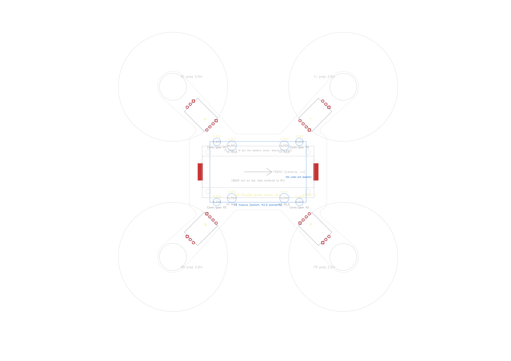

# Drone_1S_Pico2W: electronics for the 1S toothpick drone

Two boards for the 140 mm, single-18650 quad in
[OpenScad-Designs/Drones/1S_PiZero](https://github.com/arkadiraf/OpenScad-Designs/tree/main/Drones/1S_PiZero).
The flight controller is a **Raspberry Pi Pico 2 W** (RP2350 + CYW43439) on a new, custom module board.
It replaces the Crazyflie Bolt of the OpenSCAD design.

**The FC module leads the design and the frame follows it.** The OpenSCAD frame was drawn for the
Bolt, so the imported frame is only a mechanical baseline (outline, motor and ESC positions). Its
FC holes, connectors and wiring will be redone to suit the new FC and the 2 × 10 interface.

The design intent comes from
[Materials/Toothpick_Drone_Hardware_Design_1S_Pico_2_W.pdf](Materials/Toothpick_Drone_Hardware_Design_1S_Pico_2_W.pdf)
(2026-11-25). Its text is in `Materials/extracted/design_doc.txt`.

| Board | Folder | Size | Thickness | Carries |
|---|---|---|---|---|
| **Frame** (power board) | [Frame/](Frame/) | 117 × 117 mm, the quad frame itself | **2.0 mm** | 18650 tab pads, USB-C + BQ25606 charger, TPS22810 Pico rail switch + SPDT slide switch, 4 × TPS22997 motor switches, TPS61235P 5.1 V boost (optional), 4 × DYS XSD7A ESCs on pin headers, Pi Zero 5.1 V output, 2 × 10 header to the FC |
| **FC** (flight controller module) | [FC/](FC/) | 55.3 × 41.5 mm bbox, minimum outline | 1.6 mm | **Top:** Pico 2 W only (castellated SMD, faces the frame). **Bottom:** BMI088 IMU (SPI0), BMP388 baro (I2C0), support ICs, and the Crazyflie deck connectors for the Flow deck v2 (SPI1 + I2C0), which plugs in from below as it does under a Crazyflie. Also JST-SH 4 to the Pi Zero and the 2 × 10 header to the frame |

## Status: stage 1, bare boards (rev 0.1)

| Stage | Content | State |
|---|---|---|
| 1 | Outlines, holes, fixed pads, placement guides, design rules | **done** |
| 2 | Pin map and netlist in `design.py`: Pico 2 W GPIO allocation, 2 × 10 header pinout (shared by both boards) | next |
| 3 | Symbols/footprints (TPS22997 WQFN-HR, TPS22810, BQ25606, BMI088, BMP388, ...), schematics | |
| 3b | **3D review of components and placement (OpenSCAD) - routing starts only after it is approved** | in review |
| 4 | Routing, pours, DRC, fab outputs (see `../AGENTS.md`) | |




Guides: **Dwgs.User** shows top-side parts (props, cell, Pi Zero, Pico). **Cmts.User** shows
bottom-side parts (FC module outline on the frame, Crazyflie deck rows on the FC). Edit them freely.
They don't go to the fab.

### Frame: imported from OpenSCAD

Source: `1S_PiZero.scad`, `part="pcb_outline"`, exported as `1S_PiZero_PCB_outline.dxf` (OpenScad-Designs
commit `115559d`). A copy is in `Materials/extracted/`. The committed DXF was checked against a fresh
OpenSCAD export of the same scad file: same 60 holes, same outline.

`tools/dxf_import.py` takes the largest contour as the outline (312 segments on Edge.Cuts). It fits every
other contour as a circle and snaps it to a known drill:

| Drill | Count | Became | Ref |
|---|---|---|---|
| 4.0 | 4 | motor shaft clearance, NPTH | H1–H4 (with the motor screws) |
| 2.2 | 16 | motor M2 screws, 9 mm PCD, NPTH | H1–H4 (`MotorMount_1203_M2_9mm`) |
| 2.2 | 4 | the shared M2 holes: battery cover + landing gear + FC standoffs, NPTH | H_CV1–4 |
| 1.0 | 28 | ESC header pins, **plated**, 1.7 mm pads | J1–J4: pads 1–4 inner row (power end), 5–7 outer row (motor phases) |
| 0.75 | 2 | JST-PH holes for the Pi 5.1 V connector (JST ePH drill) | J8 (`JST_PH_B2B-PH-K_1x02_P2.00mm_Vertical`), pads asserted on the holes |

Plus **BT1**, the two 3 × 10 mm battery tab pads on top copper at x = ±33.6 mm (from `pcb()` in the
scad). Polarity is not set yet.

`tools/check_import.py` checks every drilled hole in the board against the DXF (within 0.01 mm, same
drill) and checks the outline segment count. Result: `IMPORT OK`, 58 holes.

Motor and ESC names: FL, FR, RR, RL (x forward to the camera, y left). In KiCad the front points right.

### Board-to-board: plug-in FC on standoffs

The FC module sits **under the frame** (the frame top over the centre carries the 18650 and its
cover). It **plugs into the frame through male/female headers**. Nothing is soldered between the
boards, so the FC can be pulled off and replaced.

**The battery cover and the FC share four M2 holes** at (±24, ±17.5). The printed battery cover
also carries the Pi Zero 2 W posts. One bolt stack per hole, top to bottom:

| Layer | Thickness | |
|---|---|---|
| M2 × 8 screw, head on the cover boss | | into the standoff, 2.0 mm of thread |
| printed battery cover boss + rail | 4 mm | |
| frame PCB | 2.0 mm | H_CV1–4 |
| M2 × 5 standoff, female-female, 4 mm hex | 5 mm | lowest standard length over the Pico USB |
| FC module | 1.6 mm | H1–H4 (ears) |
| M2 × 4 screw from below | | 2.4 mm of thread |

**The landing gear has its own four M2 holes** (H_LG1–4) at (±35, ±18.5), near the front and rear
ends of the centre plate and outside the cover rails, so it swaps without touching the cover or the
FC. It is two identical printed skids (front, rear). Each skid is a cross-beam with an M2 heat-set
insert boss and a leg at each end, held by M2 × 4 screws from the frame top. A one-piece frame would
run into the FC standoffs at y = ±17.5. The frame's old 30.5 mm FC holes are gone.

**Connector choice: low profile on a standard standoff.**
* **What sets the height:** the Pico 2 W's micro-USB is its tallest part, **3.73 mm** above the FC.
  * Measured in the KiCad-RP-Pico 3D model (`ncarandini/KiCad-RP-Pico`, `Pico.wrl`): the original
    Pico, same USB part. BOOTSEL is 2.08 mm, everything else ≤ 1.68 mm.
  * So **5 mm** is the lowest standard M2 standoff that clears it, with 1.2 mm to spare; 4 mm
    would leave 0.2 mm.
* **The stack:** one connector system, Bitcraze's, as on the Flow deck.

| Board | Ref | Side | Part | Height |
|---|---|---|---|---|
| Frame | J5 (left), J6 (right) | bottom | **Bitcraze female deck connector** 1×10 2.00 mm SMD (`Bitcraze_FemaleDeck_1x10_P2.00mm_SMD`, pads from its datasheet drawing: 0.89 × 2 mm, ±1.7 mm stagger), no holes | 2.1 mm |
| FC | J1 (left, +y), J2 (right, −y) | top | 2.00 mm male header, through-hole (`PinHeader_1x10_P2.00mm_Vertical`): **Bitcraze short pins** (9 / 2 / 2 mm), short side soldered into the FC, long side up, trimmed to ~2.8 mm above the plastic | 2.0 mm plastic |

* **Mated:** 2.0 + 2.1 = 4.1 mm + 0.9 mm air on the 5 mm standoff. The pins enter the sockets about
  1.9 mm, and nothing passes through the frame.
* **Pin budget (`B2B_SIGNALS` in `design.py`):** 17 signals + VSYS + 2 × GND = 20.
  * ON1–4, PG1–4, DSHOT1–4, BOOST_EN, CHG_PG, and the Pi link PI_TX, PI_RX, PI_STATUS.
  * Assigned to pins in stage 2.

**Connectors to the Pi Zero 2 W, on the frame top:**
* **J7, Pi UART:** JST-SH 4, SM04B-SRSS-TB, side entry, at (5, 18.3). Carries GND, TX, RX, PI_STATUS
  (1 k series resistors on the FC side, per the design doc).
* **J8, Pi 5.1 V:** JST-PH 2, B2B-PH-K vertical, on the scad's two PH holes. The holes are now
  0.75 mm, JST's drill as in the KiCad footprint (was 0.8).

### FC module

**Outline, the minimum that holds the Pico 2 W and the Flow deck** (`fc_outline_pts()` in `gen_pcb.py`,
built with KiCad's polygon engine). It is the union of:
* the **Pico band**: x −28…23, |y| ≤ 12.5 (the Pico's lands reach |y| 11.29);
* a **middle block**: |x| ≤ 12.5, |y| ≤ 16.5, for the deck connector pads (|y| ≤ 13.4) and the J1/J2
  header pads (|y| ≤ 15.7);
* **four ears**: r 3.2 mm round the shared holes, joined to the band.

The 14 × 9 mm antenna notch is subtracted and all corners are filleted 1 mm. Bounding box
55.3 × 41.5 mm.

**Sensors (the Crazyflie set, from Bitcraze's open designs).** The Crazyflie 2.1 / Bolt 1.1 use
exactly these sensors, so their open schematics (bitcraze/hardware, CC-BY-NC-SA 4.0) are the
reference circuits:
* **BMI088** on SPI (PS to GND), separate accel/gyro chip selects. INT1 → INT_ACC; INT2 and INT3 →
  INT_GYR. 100 nF decoupling, supply from a filtered analog rail (Bolt: LDO + 1 µH + 4.7 µF).
* **BMP388** on I2C (CSB and SDO to VDD, address 0x77), 100 nF.

**Placement**, on the FC bottom, in the cavity between the deck rows under the Flow deck:
* **U2 BMI088 at (0, 0):** the frame centre, near the CG and on the Flow deck axis. Its long side
  runs along x so the package axes line up with the drone's (axis remap in firmware).
* **U3 BMP388 at (−6, 0):** under the deck board, so it is sheltered from prop wash and light, as
  the design doc asks.
* **C1, C2:** 100 nF 0402 next to each.
* The parts are 1.0 mm (BMI088) and 0.75 mm (BMP388) tall, well under the 4.1 mm deck connector
  stack.
* The rear part of the Pico band (x −27…−12) stays free for support ICs (IMU supply filter, etc.).

Package sources (the Bosch site and distributors are blocked from this container, so the data was
cross-checked from open designs and STEP models):
* **BMI088:** 4.5 × 3.0 × 1.0 mm, from Bosch's STEP model (via bit-bots). LGA-16 pads 0.35 × 0.59 mm,
  identical in ArduPilot (HKUST NxtPX4v2) and bit-bots. **Check pin 1 against the Bosch datasheet
  before routing.**
* **BMP388:** 2.0 × 2.0 × 0.75 mm, from its STEP model (LCSC via atopile). Pads as OpenAXES and the
  KiCad generator footprint made from BST-BMP388-DS001.

| Ref | Side | Part | Source |
|---|---|---|---|
| U1 | top | `RPi_Pico_2_W_SMD_Castellated` at x = −2.5, micro-USB at the rear edge, antenna forward over the **14 × 9 mm notch** | Pico 2 W datasheet Fig. 5 (SMT footprint) and §2.2.1 (keep-out). Fig. 5 has the same dimensions as the Pico W |
| P1, P2 | bottom | **male** 1×10 2.00 mm SMD headers (`PinHeader_1x10_P2.00mm_Vertical_SMD_Pin1Left`), pins down into the Flow deck's female connectors; rows **22.0 mm apart**, centred, pin 1 at the front | Rows: Bitcraze deck template (c8f9a2e). The Flow deck carries the Bitcraze female deck connector (20.5 × 2.0 × 2.1 mm, datasheet in bitcraze/hardware) |
| U2, C1 | bottom | BMI088 `Bosch_LGA-16_3x4.5mm_P0.5mm` + 100 nF | see above |
| U3, C2 | bottom | BMP388 `Bosch_LGA-10_2x2mm_P0.5mm` + 100 nF | see above |
| J1, J2 | top | 1×10 2.00 mm male headers to the frame (Bitcraze short pins, see above) | |
| H1–H4 | ears | M2, on the shared cover holes | same holes as frame H_CV1–4 (`check_mating.py`) |

* **Flow deck v2 (verified):** Bitcraze datasheet and mechanical drawing (bitcraze/hardware).
  * Size 21.079 × 27.940 mm, 4 mm overall, 1.6 g.
  * The FRONT arrow runs along the connector rows, with pin 1 of both rows at the front, as placed.
  * It carries the female sockets on its top, so the FC needs male pins.
  * Pin use, from its schematic (rev A):
    * PMW3901 on SPI (SCK / MISO / MOSI = right pins 3–5, CS = IO_3 = left pin 8);
    * VL53L1x on I2C (left pins 4–5);
    * VCC (left 1) feeds both sensors; VCOM (right 9) feeds the PMW3901's 1.8 V LDO; GND (left 10);
    * 1-wire ID memory on OW (right 8);
    * RESET / MOTION / GPIO1 not fitted.
  * Crazyflie VCC is 2.8 V, and ours is the Pico's 3.3 V. Check the PMW3901 and VL53L1x supply
    ranges before stage 2.
* **Why the deck headers are SMD:** the rows (y = ±11 mm) fall right under the Pico's edge lands
  (22.58 mm wide). Through-hole pins would come up into the Pico's pads. `gen_pcb.py` asserts that
  P1/P2 are on B.Cu with pin 1 at the front.
* **Deck pinout** (`DECK_LEFT` / `DECK_RIGHT` in `design.py`, from `crazyflie_deck_pinout.png`), top
  view, front up:
  * Left row P1: VCC_3V, UART1 RX/TX, I2C SDA/SCL, IO_1–IO_4, GND.
  * Right row P2: UART2 RX/TX, SPI SCK/MISO/MOSI, three nRF lines, VCOM, VUSB.
* **Correction:** the OpenSCAD Bolt drawing has `fc_deck_rows = 17` (and draws 2.54 mm headers). The
  Bitcraze template says 22.0 mm and 2.00 mm. The scad only uses this for its drawing, so update it
  there too.
* **Keep-outs** on top copper under the Pico's TP1–3 and SWD pads (rule areas), so no via or track
  touches them.
* **Bottom guides:** the Flow deck v2 outline (21.079 × 27.94 mm) and the support-IC area at the rear.
* **Routing note:** the Pico's lands (top) and the deck pads (bottom) overlap in plan along both
  long edges. Pico signals have to leave their pads inward or outward on top before they via down.

## 3D review (OpenSCAD)

Placement is reviewed in 3D **before routing**. `tools/export_scad.py` writes the KiCad boards into
the drone model as `OpenScad-Designs/Drones/1S_PiZero/1S_PiZero_electronics.scad`:
* FC outline;
* every part with its side and pad positions;
* board thicknesses and standoff height.

The scad draws each part from its pads, so the 3D view shows exactly what is placed in KiCad. In the
scad:
* `part = "electronics"` shows the two boards and their parts;
* `part = "assembly"` shows the whole drone.


`1S_PiZero_verify.py` (OpenSCAD repo) checks the frame against the part drawings. Since this stage it
also checks that the FC stack (module, its frame sockets, the Flow deck) clears the frame, the landing
gear, the ESCs and the screws/standoffs.

Model values still to confirm with real parts (marked "to check" in the scad):
* Pico micro-USB height (2.7 mm) and top-side parts envelope (1.2 mm);
* board-to-board: Bitcraze pins trimmed to ~2.8 mm, JST-SH height (2.95 mm modelled);
* deck header plastic 2.0 mm (+ the Bitcraze socket 2.1 mm = 4.1 mm stack), deck PCB 0.8 mm;
* sensor positions on the deck (from the product photo);
* PMW3901 / VL53L1x fields of view (42° / 27°, nominal).

The verify script also checks that nothing (landing gear, ESCs, screws, FC, prop guard) sits in
the Flow deck sensors' view cones down to the ground.

## Firmware

Bitcraze publishes the Crazyflie flight firmware (GPL-3.0). It already has drivers for the BMI088,
BMP388, PMW3901, VL53L1x and DShot ESCs. Espressif's ESP-Drone is a working port of it to another
MCU over Wi-Fi. No RP2350 port exists yet. Findings and the port plan are in
[firmware/README.md](firmware/README.md).

## Design summary (from the design doc)

* **Power:** a 1S 18650 cell (30 A peak) feeds two paths.
  * **A, logic:** TPS22810 load switch to Pico VSYS (0.5 A). UVLO at about 2.54 V on / 2.41 V off.
    An SPDT slide switch drives EN/UVLO and only carries the signal.
  * **B, motors:** one TPS22997 per ESC, high side, about 7.5 A each.
    * ON comes from a Pico GPIO, with a 100 k pull-down: Pico off means motors off.
    * PG is open-drain with a 47 k pull-up to 3V3, read by the Pico.
    * CT sets the soft start. QOD is tied to VOUT.
* **Charger:** BQ25606 from USB-C.
  * 5.1 k pull-downs on CC.
  * R_ICHG 226 Ω for 3.0 A. R_ILIM 150 Ω for 3.2 A.
  * VSET floats (4.208 V). 10 k NTC on TS. 1 µH inductor.
  * SYS feeds the TPS22810 only. The motors stay on BAT. PG goes to the header.
* **Boost (optional):** TPS61235P, 5.1 V for the Pi Zero, enabled by a Pico GPIO (100 k pull-down).
  * Pico ↔ Pi link: JST-SH 4 on the FC (GND, TX, RX, PI_STATUS) with 1 k series resistors.
* **Header:** the frame ↔ FC header is 2 × 10, 2.54 mm. It carries VSYS, 4 × ON, 4 × PG,
  4 × DShot, BOOST_EN, CHG_PG and GND.
* **Firmware protection:**
  * The Pico reads the cell on GPIO29 (VSYS/3) and lands at 3.0–3.2 V resting.
  * The TPS22810 lockout is the hardware backstop.

### Open items carried from the doc

* [ ] Measure full-throttle current per motor (2520 props). It must stay under the XSD7A's 7 A.
* [ ] Reverse-polarity protection on the ESC power leads.
* [ ] Internal 2.54 V lockout vs the 2.70 / 3.30 V divider (R1 156 k, R2 100 k, R3 1.27 M).
* [ ] Worst-case thresholds against datasheet min/max.
* [ ] Check the TPS22997 WQFN-HR land pattern for hand assembly.

### Open items from stage 1

* [ ] ESC header pin functions (pads 1–4: which is BAT+, GND, signal) need the XSD7A pad layout.
* [ ] Pick the header/socket pair and standoff length (6 mm planned) from real datasheets. The OpenSCAD
      model already uses 2.0 mm frame, 6 mm standoffs, 22 mm / 2.00 mm deck rows (from KiCad).
* [ ] The 20-pin assignment of J1/J2 ↔ J5/J6. The doc's bus fits: VSYS, 4 × ON, 4 × PG, 4 × DShot,
      BOOST_EN, CHG_PG, GND.
* [ ] Deck connector gender and height, to mate the Flow deck v2's own headers (check the Flow deck v2
      docs and schematic), and the Flow deck v2 pin use (CS pin, supply pin).
* [ ] The Pico 2 W antenna faces up at the frame. Keep frame copper out above the antenna area, or
      move the antenna out from under the frame.
* [ ] Battery tab polarity (BT1 pad 1 is at the front).
* [ ] Datasheets still to collect into `Materials/`: TPS22810, TPS22997, BQ25606, TPS61235P,
      BMI088, BMP388, Flow deck v2 and Crazyflie Bolt schematics, DYS XSD7A.

## Regenerate

```sh
cd tools
python3 gen_libs.py                   # Drone_1S.pretty + fp-lib-tables
python3 dxf_import.py                 # outline + hole summary from the DXF
/usr/bin/python3 gen_pcb.py           # both boards + DRC (build/*_drc.txt), prints DRC OK
/usr/bin/python3 check_import.py      # frame holes == DXF, prints IMPORT OK
/usr/bin/python3 check_mating.py      # FC J1/J2 + holes == frame J5/J6 + holes, prints MATING OK
/usr/bin/python3 export_scad.py       # -> OpenScad-Designs/Drones/1S_PiZero/1S_PiZero_electronics.scad
python3 render.py                     # docs/*.png
```

When the OpenSCAD frame changes, export `part="pcb_outline"` to DXF, copy it to
`Materials/extracted/1S_PiZero_PCB_outline.dxf`, update `SCAD` in `design.py`, and regenerate.

Current results: Frame 15 footprints / 74 pads, FC 9 footprints / 88 pads. `MATING OK`. DRC **0 violations, 0 unconnected,
0 footprint errors** on both boards. `IMPORT OK`. The boards haven't been opened in the KiCad GUI (KiCad
7.0.11 in the container). The `.kicad_pcb` files are KiCad 7 format and open in 8 and 9.
