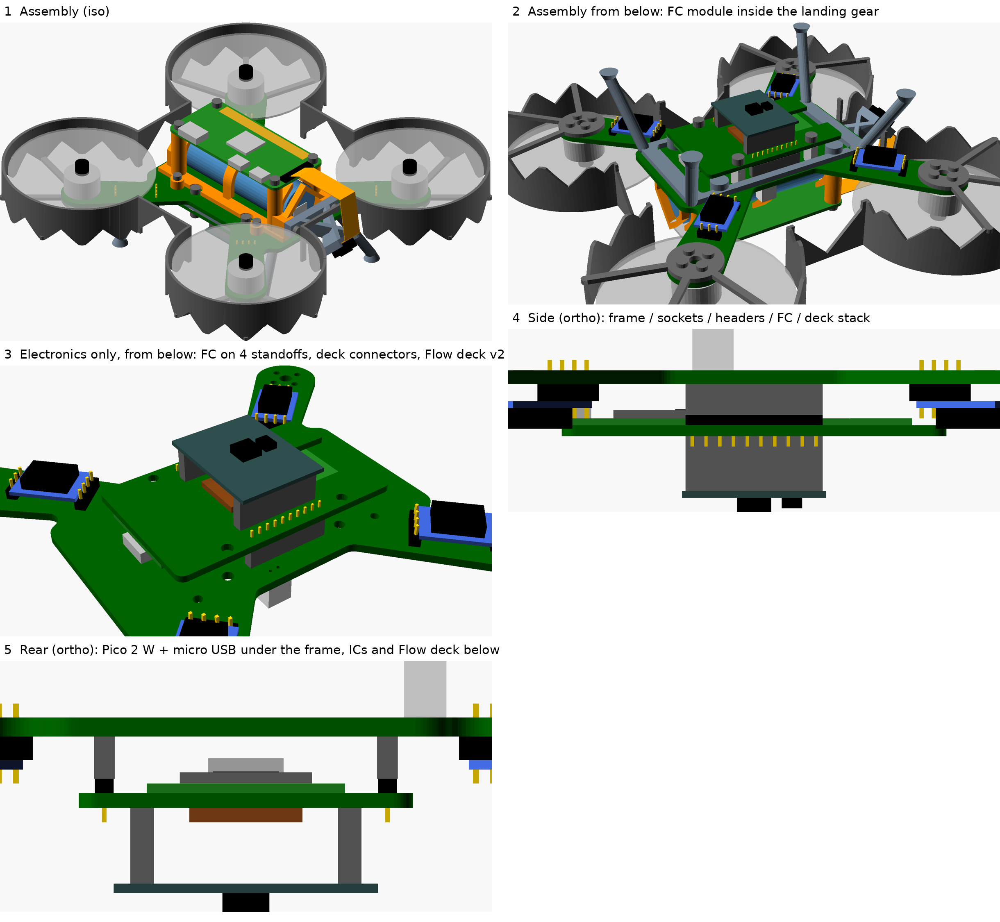

# Drone_1S_Pico2W: electronics for the 1S toothpick drone

Two boards for the 140 mm, single-18650 quad in
[OpenScad-Designs/Drones/1S_PiZero](https://github.com/arkadiraf/OpenScad-Designs/tree/main/Drones/1S_PiZero).
The flight controller is a **Raspberry Pi Pico 2 W** (RP2350 + CYW43439) on a new, custom module board.
It replaces the Crazyflie Bolt of the OpenSCAD design.

**The FC module leads the design and the frame follows it.** The OpenSCAD frame was drawn for the
Bolt, so the imported frame is only a mechanical baseline (outline, motor and ESC positions). Its
FC holes, connectors and wiring will be redone to suit the new FC and the 2 × 10 interface.

The design intent comes from
[Materials/Toothpick_Drone_Hardware_Design_1S_Pico_2_W.pdf](Materials/Toothpick_Drone_Hardware_Design_1S_Pico_2_W.pdf)
(2026-11-25). Its text is in `Materials/extracted/design_doc.txt`.

| Board | Folder | Size | Thickness | Carries |
|---|---|---|---|---|
| **Frame** (power board) | [Frame/](Frame/) | 117 × 117 mm, the quad frame itself | **2.0 mm** | 18650 tab pads, USB-C + BQ25606 charger, TPS22810 Pico rail switch + SPDT slide switch, 4 × TPS22997 motor switches, TPS61235P 5.1 V boost (optional), 4 × DYS XSD7A ESCs on pin headers, Pi Zero 5.1 V output, 2 × 10 header to the FC |
| **FC** (flight controller module) | [FC/](FC/) | 56 × 35.4 mm | 1.6 mm | **Top:** Pico 2 W only (castellated SMD, faces the frame). **Bottom:** BMI088 IMU (SPI0), BMP388 baro (I2C0), support ICs, and the Crazyflie deck connectors for the Flow deck v2 (SPI1 + I2C0), which plugs in from below as it does under a Crazyflie. Also JST-SH 4 to the Pi Zero and the 2 × 10 header to the frame |

## Status: stage 1, bare boards (rev 0.1)

| Stage | Content | State |
|---|---|---|
| 1 | Outlines, holes, fixed pads, placement guides, design rules | **done** |
| 2 | Pin map and netlist in `design.py`: Pico 2 W GPIO allocation, 2 × 10 header pinout (shared by both boards) | next |
| 3 | Symbols/footprints (TPS22997 WQFN-HR, TPS22810, BQ25606, BMI088, BMP388, ...), schematics | |
| 3b | **3D review of components and placement (OpenSCAD) - routing starts only after it is approved** | in review |
| 4 | Routing, pours, DRC, fab outputs (see `../AGENTS.md`) | |


Guides: **Dwgs.User** shows top-side parts (props, cell, Pi Zero, Pico). **Cmts.User** shows
bottom-side parts (FC module outline on the frame, Crazyflie deck rows on the FC). Edit them freely.
They don't go to the fab.

### Frame: imported from OpenSCAD

Source: `1S_PiZero.scad`, `part="pcb_outline"`, exported as `1S_PiZero_PCB_outline.dxf` (OpenScad-Designs
commit `115559d`). A copy is in `Materials/extracted/`. The committed DXF was checked against a fresh
OpenSCAD export of the same scad file: same 60 holes, same outline.

`tools/dxf_import.py` takes the largest contour as the outline (312 segments on Edge.Cuts). It fits every
other contour as a circle and snaps it to a known drill:

| Drill | Count | Became | Ref |
|---|---|---|---|
| 4.0 | 4 | motor shaft clearance, NPTH | H1–H4 (with the motor screws) |
| 2.2 | 16 | motor M2 screws, 9 mm PCD, NPTH | H1–H4 (`MotorMount_1203_M2_9mm`) |
| 2.2 | 4 | battery-cover / landing-gear M2 screws, NPTH | H_CV1–4 |
| 2.7 | 4 | FC module M2.5 screws, 30.5 mm square, NPTH | H_FC1–4 |
| 1.0 | 28 | ESC header pins, **plated**, 1.7 mm pads | J1–J4: pads 1–4 inner row (power end), 5–7 outer row (motor phases) |
| 0.8 | 4 | JST-PH holes of the Bolt-era J1 "Pi power" / J3 "Bolt power" | **dropped**: they come back as real connector footprints in stage 3 |

Plus **BT1**, the two 3 × 10 mm battery tab pads on top copper at x = ±33.6 mm (from `pcb()` in the
scad). Polarity is not set yet.

`tools/check_import.py` checks every drilled hole in the board against the DXF (within 0.01 mm, same
drill) and checks the outline segment count. Result: `IMPORT OK`, 56 holes.

Motor and ESC names: FL, FR, RR, RL (x forward to the camera, y left). In KiCad the front points right.

### Board-to-board: plug-in FC on standoffs

The FC module sits **under the frame** (the frame top over the centre carries the 18650 and its
cover). It hangs on **4 × M2.5 standoffs** and **plugs into the frame through male/female headers**.
Nothing is soldered between the boards, so the FC can be pulled off and replaced.

| Board | Ref | Side | Part |
|---|---|---|---|
| FC | J1 (left, +y), J2 (right, −y) | top, pins up | male pin header 1×10, **2.00 mm**, through-hole (`Connector_PinHeader_2.00mm:PinHeader_1x10_P2.00mm_Vertical`) |
| Frame | J5 (left), J6 (right) | bottom, facing down | female socket 1×10, **2.00 mm**, SMD (`Connector_PinSocket_2.00mm:PinSocket_1x10_P2.00mm_Vertical_SMD_Pin1Left`) |

* **Why 2.00 mm:** the rows run beside the Pico at y = ±15 mm, between the M2.5 standoffs. A 2.54 mm
  1×10 (25.4 mm plus body) runs into the standoff hexes at x = ±12.35 mm. The 2.00 mm row (20 mm)
  clears them. 2 × 10 pins = the 20-pin bus from the design doc.
* **Why y = ±15:**
  * clear of the Pico courtyard (±11.55) and of the deck pads on the FC bottom (|y| ≤ 13.4);
  * the FC's pin tails stay outside the Flow deck board (|y| ≤ 13.65).
* **Why SMD sockets on the frame:** through-hole tails would come up under the battery-cover rails on
  the frame top.
* **Pin 1** of both rows is at the front. Pin k is at x = 9 − 2(k−1) mm, the same on both boards.
* **Checks:**
  * `gen_pcb.py` asserts every pin position on both boards.
  * `check_mating.py` compares the two boards: same pin numbers at the same plan position (the SMD
    socket pads sit 1.6 mm off the pin line by design), and the M2.5 holes line up. Result:
    `MATING OK`.
* **Stack height:** standoff length = socket body + header plastic. `B2B["standoff"]` = 6 mm, for
  example a 4.5 mm socket + a 1.5 mm header. The Pico 2 W is about 4 mm tall at its micro-USB, which
  leaves about 2 mm under the frame. The frame bottom shows the Pico area as "only low parts here".
  Confirm both heights with the parts you buy.

### FC module

Placed so far (no nets yet). Footprints are in `Drone_1S.pretty`, generated by `tools/gen_libs.py`:

| Ref | Side | Part | Source |
|---|---|---|---|
| U1 | top | `RPi_Pico_2_W_SMD_Castellated` at x = −2.5, micro-USB at the rear edge, antenna forward over a **14 × 9 mm notch** | Pico 2 W datasheet Fig. 5 (SMT footprint) and §2.2.1 (keep-out). Fig. 5 has the same dimensions as the Pico W, so the geometry is the one checked in Pico_Alvik_Adapter |
| P1, P2 | bottom | `CF_Deck_1x10_P2.00mm_SMD`: Crazyflie deck rows, **2.00 mm pitch, 22.0 mm apart**, centred on the board (= frame centre / CG), pin 1 of both rows at the front | Bitcraze [crazyflie2-exp-template-electronics](https://github.com/bitcraze/crazyflie2-exp-template-electronics) (c8f9a2e, CC-BY 3.0): footprint `CF2-DECK-SMD-HOLES` (SMD pads only) and P1/P2 positions. Copies in `Materials/extracted/` |
| J1, J2 | top | 1×10 2.00 mm male headers to the frame (see above) | |
| H1–H4 | – | M2.5, 30.5 mm square, for the standoffs | same holes as frame H_FC1–4 |

* **Why the deck connectors are SMD:** the rows (y = ±11 mm) fall right under the Pico's edge lands
  (22.58 mm wide). Through-hole pins would come up into the Pico's pads. `gen_pcb.py` asserts that
  P1/P2 are on B.Cu with pin 1 at the front.
* **Deck pinout** (`DECK_LEFT` / `DECK_RIGHT` in `design.py`, from `crazyflie_deck_pinout.png`), top
  view, front up:
  * Left row P1: VCC_3V, UART1 RX/TX, I2C SDA/SCL, IO_1–IO_4, GND.
  * Right row P2: UART2 RX/TX, SPI SCK/MISO/MOSI, three nRF lines, VCOM, VUSB.
* **Correction:** the OpenSCAD Bolt drawing has `fc_deck_rows = 17` (and draws 2.54 mm headers). The
  Bitcraze template says 22.0 mm and 2.00 mm. The scad only uses this for its drawing, so update it
  there too.
* **Keep-outs** on top copper under the Pico's TP1–3 and SWD pads (rule areas), so no via or track
  touches them.
* **Bottom guides:** the Flow deck v2 board outline (25.2 × 27.3 mm), and the BMI088 spot in the
  centre between the deck rows, close to the CG. ICs there must stay lower than the deck connector
  stack.
* **Routing note:** the Pico's lands (top) and the deck pads (bottom) overlap in plan along both
  long edges. Pico signals have to leave their pads inward or outward on top before they via down.

## 3D review (OpenSCAD)

Placement is reviewed in 3D **before routing**. `tools/export_scad.py` writes the KiCad boards into
the drone model as `OpenScad-Designs/Drones/1S_PiZero/1S_PiZero_electronics.scad`:
* FC outline;
* every part with its side and pad positions;
* board thicknesses and standoff height.

The scad draws each part from its pads, so the 3D view shows exactly what is placed in KiCad. In the
scad:
* `part = "electronics"` shows the two boards and their parts;
* `part = "assembly"` shows the whole drone.



`1S_PiZero_verify.py` (OpenSCAD repo) checks the frame against the part drawings. Since this stage it
also checks that the FC stack (module, its frame sockets, the Flow deck) clears the frame, the landing
gear, the ESCs and the screws/standoffs.

Model values still to confirm with real parts (marked "to check" in the scad):
* Pico micro-USB height (2.7 mm) and top-side parts envelope (1.2 mm);
* header plastic 1.5 mm + socket 4.5 mm on 6 mm standoffs;
* Flow deck v2 21 × 28 mm on an 8 mm connector stack;
* FC underside IC envelope 1.5 mm.

## Design summary (from the design doc)

* **Power:** a 1S 18650 cell (30 A peak) feeds two paths.
  * **A, logic:** TPS22810 load switch to Pico VSYS (0.5 A). UVLO at about 2.54 V on / 2.41 V off.
    An SPDT slide switch drives EN/UVLO and only carries the signal.
  * **B, motors:** one TPS22997 per ESC, high side, about 7.5 A each.
    * ON comes from a Pico GPIO, with a 100 k pull-down: Pico off means motors off.
    * PG is open-drain with a 47 k pull-up to 3V3, read by the Pico.
    * CT sets the soft start. QOD is tied to VOUT.
* **Charger:** BQ25606 from USB-C.
  * 5.1 k pull-downs on CC.
  * R_ICHG 226 Ω for 3.0 A. R_ILIM 150 Ω for 3.2 A.
  * VSET floats (4.208 V). 10 k NTC on TS. 1 µH inductor.
  * SYS feeds the TPS22810 only. The motors stay on BAT. PG goes to the header.
* **Boost (optional):** TPS61235P, 5.1 V for the Pi Zero, enabled by a Pico GPIO (100 k pull-down).
  * Pico ↔ Pi link: JST-SH 4 on the FC (GND, TX, RX, PI_STATUS) with 1 k series resistors.
* **Header:** the frame ↔ FC header is 2 × 10, 2.54 mm. It carries VSYS, 4 × ON, 4 × PG,
  4 × DShot, BOOST_EN, CHG_PG and GND.
* **Firmware protection:**
  * The Pico reads the cell on GPIO29 (VSYS/3) and lands at 3.0–3.2 V resting.
  * The TPS22810 lockout is the hardware backstop.

### Open items carried from the doc

* [ ] Measure full-throttle current per motor (2520 props). It must stay under the XSD7A's 7 A.
* [ ] Reverse-polarity protection on the ESC power leads.
* [ ] Internal 2.54 V lockout vs the 2.70 / 3.30 V divider (R1 156 k, R2 100 k, R3 1.27 M).
* [ ] Worst-case thresholds against datasheet min/max.
* [ ] Check the TPS22997 WQFN-HR land pattern for hand assembly.

### Open items from stage 1

* [ ] ESC header pin functions (pads 1–4: which is BAT+, GND, signal) need the XSD7A pad layout.
* [ ] Pick the header/socket pair and standoff length (6 mm planned) from real datasheets. The OpenSCAD
      model already uses 2.0 mm frame, 6 mm standoffs, 22 mm / 2.00 mm deck rows (from KiCad).
* [ ] The 20-pin assignment of J1/J2 ↔ J5/J6. The doc's bus fits: VSYS, 4 × ON, 4 × PG, 4 × DShot,
      BOOST_EN, CHG_PG, GND.
* [ ] Deck connector gender and height, to mate the Flow deck v2's own headers (check the Flow deck v2
      docs and schematic), and the Flow deck v2 pin use (CS pin, supply pin).
* [ ] The Pico 2 W antenna faces up at the frame. Keep frame copper out above the antenna area, or
      move the antenna out from under the frame.
* [ ] Battery tab polarity (BT1 pad 1 is at the front).
* [ ] Datasheets still to collect into `Materials/`: TPS22810, TPS22997, BQ25606, TPS61235P,
      BMI088, BMP388, Flow deck v2 and Crazyflie Bolt schematics, DYS XSD7A.

## Regenerate

```sh
cd tools
python3 gen_libs.py                   # Drone_1S.pretty + fp-lib-tables
python3 dxf_import.py                 # outline + hole summary from the DXF
/usr/bin/python3 gen_pcb.py           # both boards + DRC (build/*_drc.txt), prints DRC OK
/usr/bin/python3 check_import.py      # frame holes == DXF, prints IMPORT OK
/usr/bin/python3 check_mating.py      # FC J1/J2 + holes == frame J5/J6 + holes, prints MATING OK
/usr/bin/python3 export_scad.py       # -> OpenScad-Designs/Drones/1S_PiZero/1S_PiZero_electronics.scad
python3 render.py                     # docs/*.png
```

When the OpenSCAD frame changes, export `part="pcb_outline"` to DXF, copy it to
`Materials/extracted/1S_PiZero_PCB_outline.dxf`, update `SCAD` in `design.py`, and regenerate.

Current results: Frame 19 footprints / 78 pads, FC 9 footprints / 88 pads. `MATING OK`. DRC **0 violations, 0 unconnected,
0 footprint errors** on both boards. `IMPORT OK`. The boards haven't been opened in the KiCad GUI (KiCad
7.0.11 in the container). The `.kicad_pcb` files are KiCad 7 format and open in 8 and 9.
