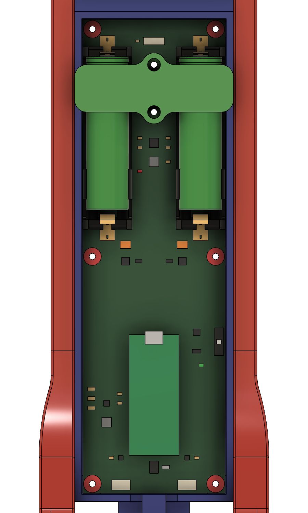

# PicoBalancer: two-wheel self-balancing robot board

One 60 × 200 × 1.6 mm PCB for a two-wheel balancing robot:
* **MCU:** Raspberry Pi Pico W (RP2040) on 2 × 20 female sockets, upgradable to a Pico 2 W (RP2350) with no board change.
* **Cells:** plain 2 × 18650 (no protection PCB) in parallel (1S2P) in Keystone 1042 holders (not polarized, Digi-Key 36-1042-ND), or the polarized 1042P on the same footprint. Each cell has its own reverse-polarity FET.
* **IMU:** BNO086 on SPI0.
* **Motors:** 2 × MP6550 H-bridges for Pololu #3072 micro metal gearmotors (30:1 HPCB 6V, extended shaft), each with a Pololu 4761 magnetic encoder on one JST-SH 6-pin connector. ISET 4.3 k caps each motor at 1.16 A.
* **Power:** the blocks are reused from [Drone_1S_Pico2W](../Drone_1S_Pico2W/): BQ25606 USB-C charger (vertical GCT USB4235), TPS22810 Pico switch with UVLO, TPS61235P 5.1 V boost.

**Design document:** [docs/PicoBalancer_Hardware_Design.pdf](docs/PicoBalancer_Hardware_Design.pdf), a PDF export of the shared
design doc (block diagram, circuits, pin map, mechanics, parts list, open decisions).
**BOM:**
* [fabrication/BOM.md](fabrication/BOM.md): every line.
* [fabrication/BOM_DigiKey.csv](fabrication/BOM_DigiKey.csv): distributor upload. Digi-Key or Mouser, whichever has stock.
* [fabrication/BOM_stock.md](fabrication/BOM_stock.md): 0603 R/C and 0805 LEDs from stock.
* [fabrication/BOM_to_source.md](fabrication/BOM_to_source.md): lines with no distributor number yet.

**Datasheets and verification:** [Materials/bom_datasheets/README.md](Materials/bom_datasheets/README.md).

## Status: stage 0 (rev 0.1)

| Stage | Content | State |
|---|---|---|
| 0 | Folder, datasheets, outline + holes from the DXF (checked against Fusion), placement guides, BOM, design doc | **done** |
| 1 | Decisions closed (motor, cells, TS fixed, UVLO option, placement); follow-up: BAT fuse | done |
| 2 | Netlist in `design.py`, KD symbols/footprints (BNO086, MP6550, 1042P, USB4235, EG1218), schematic | |
| 3 | Placement, 3D review against the Fusion model, routing | |
| 4 | DRC, fab outputs | |


## Mechanics

Sources: `Materials/extracted/PicoBalancer_PCB.dxf` and the Fusion 360 model `PicoBalancer_V01 v2`. The model was
read only, over its local MCP server, and **must not be changed without approval.**

Board coordinates: origin at the board centre, x right, y down, viewed from the holder side. The wheel end is at +y.
Fusion: `y_kicad = 121 - y_fusion`.

| Item | Position (mm) |
|---|---|
| Outline | 60 × 200 |
| Holes | 6 × Ø2.65 NPTH (M2.5) at x ±26, y −96 / 0 / +96, 8 × 8 squares from the DXF and Ø7.5 mm head keep-out marks; 2 clamp holes at (0, −61) / (0, −81) (`KD_Mechanical:MountingHole_2.65mm_NPTH`) |
| BT1 / BT2 (1042, alt. 1042P) | centres (±19.675, −49.975): outer walls on the board edges, top end 11.5 mm from the top edge, + contact toward the board centre; pads ≥ 7.46 × 6.47 mm, ≥ 86.80 mm overall, holes Ø3.45 / Ø2.39 mm |
| Channel between holders | x ±8.65, y −93.5…−6.9: vertical USB-C at the top, BQ25606 charger below, two battery-clamp holes in the middle (positions to come from Fusion) |
| Pico | centred, x ±10.5, y 33…84 (antenna end 2.4 mm above the IMU), micro-USB up |
| IMU | centre bottom, about (0, 89): nearest the wheel axle |
| J3 / J4 motor connectors | bottom edge, left / right, with U3 / U4 drivers right above |

Fusion findings, reported but not changed:
* The 1042P locating pegs pass through the PCB body.
* The PCB body has no holes for those pegs.

## Placement review in Fusion 360 (stage 0b)

`tools/fusion/build_review.py` builds a `PCB_Review` component in the Fusion model (user permission, 27 Nov 2026) from
`design.py`. It contains a 60 × 200 mm board with all holes and one sized block per part (`REVIEW_PARTS`). It also moves
the two holder models to `BT_POS`. The original `PCB` body is hidden. Rerun it after changing `design.py`:

```sh
cd tools/fusion
python build_review.py                 # needs Fusion running with the PicoBalancer model open (MCP server on :27182)
python fusion_mcp.py view_top.py && python screenshot.py ../../docs/fusion_review_top.png 900 1500
```

* **Bolt keep-out:** Ø7.5 mm circle marked at each M2.5 hole (5 mm head).
* **Holder position:** `HOLDER_TOP_OFFSET` is the distance from the PCB top edge to the housing top end: 11.5 mm (confirmed 27 Nov 2026, also the minimum for the keep-out).
* **Battery clamp:** holes at (0, −61) and (0, −81), with the cover pillar (x ±5, y −86…−56) kept free of parts. The charger sits below the pillar and the USB-C above it.
* **Holder joints:**
  * The left holder is positioned through the offsets of the model's rigid joint "Rigid 6".
  * The right holder is a mirrored copy in the model, so its locating bosses are on the wrong diagonal. The review PCB holes follow a real holder.



## Key electrical choices (details in the design doc)

* **Reverse-polarity protection, one channel per cell** (Q1–Q4, R28–R33). A shared FET cannot protect parallel cells.
  * Each holder's + contact goes to BAT through its own P-FET (DMP2008UFG, 9.8 mΩ max at −2.5 V).
  * A DMG2302U turns that P-FET on only when its own cell is the right way round.
  * A reversed cell is blocked, an empty holder's contacts are dead, and charging still works through the P-FET channel.
  * This makes the non-polarized Keystone 1042 safe to use.
* **Resettable fuse per cell** (F1/F2, Littelfuse 1812L260TH: 2.6 A hold, 5.2 A trip, 8 V) between each holder's + and its P-FET. A short on BAT trips both, and they cap the equalizing current when cells don't match.

* **Back-feed Schottky D2** between the TPS22810 output and Pico VSYS. The Pico's own micro-USB stays usable for
  programming and cannot push current into the cells.
* **Encoder VCC = 3V3.** The Pololu encoder pulls A/B up to its VCC, and RP2040 GPIOs are not 5 V tolerant.
* **BAT feeds both paths:** the TPS22810 (Pico VSYS) and the TPS61235P boost take their input from BAT, after the per-cell FETs. The BQ25606 SYS pin carries only its own capacitors.
* **Boost EN** comes only from the Pico (GP20, 100 k pull-down), so motor power is off by default. MOTOR_EN (GP2) gates
  both MP6550 nSLEEP_HB pins the same way.
* **Charger temperature left out:** TS is held in its normal window by R19 10 k (TH1 not fitted), so charging never stops for temperature.
* **Charging and sleep:** the robot is never driven while charging. It is left switched off to charge slowly. If the power is left on, firmware drops MOTOR_EN and BOOST_EN, sleeps the IMU and sends the Pico dormant. The TPS22810 UVLO is the last backstop: internal 2.54 / 2.41 V by default (R21 = 0 Ω), or 3.30 / 2.70 V by fitting R21 = 156 k, R22 and R23. Firmware sleeps well above it.
* **Placement:** boost on the left beside the Pico, above the left driver. Slide switch on the right edge, with the TPS22810 and D2 beside it.
* **BNO086 on SPI0** (GP4–GP7; pin-for-pin SPI wiring from the SparkFun breakout schematic v10, `design.BNO086_PINS`), with INT on GP8, RST on GP9 and WAKE on GP3. PS1 and PS0/WAKE have pull-ups.
* **Slide switch:** E-Switch EG1218 (Digi-Key EG1903-ND) on the TPS22810 EN/UVLO pin, signal only.

## Regenerate

```sh
cd tools
python export_bom.py          # fabrication/BOM*.{md,csv}, passives rule, prints BOM EXPORT OK
python datasheet_index.py     # Materials/bom_datasheets/README.md
"C:/Program Files/KiCad/10.0/bin/python.exe" gen_pcb.py     # PicoBalancer.kicad_pcb, lib tables, prints IMPORT OK
"C:/Program Files/KiCad/10.0/bin/kicad-cli.exe" pcb drc --output ../build/drc.txt ../PicoBalancer.kicad_pcb
```

Current results:
* `BOM EXPORT OK`: 58 lines.
* `IMPORT OK`: 6 holes match the DXF.
* DRC (KiCad 10.0.8): 0 violations, 0 unconnected.
