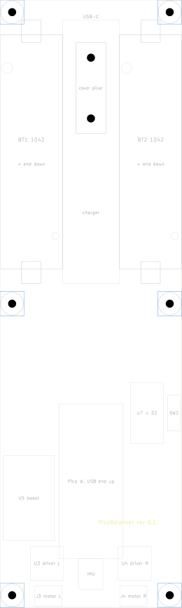
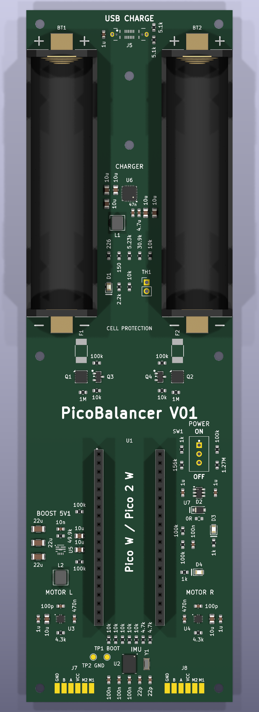

# PicoBalancer: two-wheel self-balancing robot board

One 60 × 200 × 1.6 mm PCB for a two-wheel balancing robot:
* **MCU:** Raspberry Pi Pico W (RP2040) on 2 × 20 female sockets, upgradable to a Pico 2 W (RP2350) with no board change.
* **Cells:** plain 2 × 18650 (no protection PCB) in parallel (1S2P) in Keystone 1042 holders (not polarized, Digi-Key 36-1042-ND), or the polarized 1042P on the same footprint. Each cell has its own reverse-polarity FET.
* **IMU:** BNO086 on SPI1.
* **Motors:** 2 × MP6550 H-bridges for Pololu #3072 micro metal gearmotors (30:1 HPCB 6V, extended shaft), each with a Pololu 4761 magnetic encoder on one JST-SH 6-pin connector. ISET 4.3 k caps each motor at 1.16 A.
* **Power:** the blocks are reused from [Drone_1S_Pico2W](../Drone_1S_Pico2W/): BQ25606 USB-C charger (vertical GCT USB4235), TPS22810 Pico switch with UVLO, TPS61235P 5.1 V boost.

**Design document:** [docs/PicoBalancer_Hardware_Design.pdf](docs/PicoBalancer_Hardware_Design.pdf), a PDF export of the shared
design doc (block diagram, circuits, pin map, mechanics, parts list, open decisions).
**PCB order:** [fabrication/PicoBalancer_OSHPark.zip](fabrication/PicoBalancer_OSHPark.zip) (OSH Park 2-layer). See [Fabrication](#fabrication-osh-park-stage-4).
**BOM:**
* [fabrication/BOM.md](fabrication/BOM.md): every line.
* [fabrication/BOM_DigiKey.csv](fabrication/BOM_DigiKey.csv): distributor upload. Digi-Key or Mouser, whichever has stock.
* [fabrication/BOM_stock.md](fabrication/BOM_stock.md): 0603 R/C and 0805 LEDs from stock.
* [fabrication/BOM_to_source.md](fabrication/BOM_to_source.md): lines with no distributor number yet.

**Datasheets and verification:** [Materials/bom_datasheets/README.md](Materials/bom_datasheets/README.md).
**Order check:** `python tools/verify_order.py fabrication/DigiKey_order_2026-11-27T093456.xlsx 5` compares the Digi-Key cart with the BOM. Result for the 27 Nov cart (093456): ORDER OK for 5 boards. The Pico WH comes from Mouser / Piitel. Two cart lines are Pico_Alvik_Adapter parts.

## Status: stage 4, ready to order (rev 0.1)

| Stage | Content | State |
|---|---|---|
| 0 | Folder, datasheets, outline + holes from the DXF (checked against Fusion), placement guides, BOM, design doc | **done** |
| 1 | Decisions closed (motor, cells, TS fixed, UVLO option, placement); follow-up: BAT fuse | done |
| 2 | Netlist in `design.py`, KD symbols/footprints (BNO086, MP6550, Pico socket, 1042, USB4235, slide switch, 1812L, wire pads), schematic | **done** |
| 3 | Placement, silkscreen, routing (2 layers): DRC 0 violations, 0 unconnected | **done** |
| 4 | Final review, OSH Park fab outputs (Gerbers, drill, top stencil, positions) | **done** |



## Mechanics

Sources: `Materials/extracted/PicoBalancer_PCB.dxf` and the Fusion 360 model `PicoBalancer_V01 v2`. The model was
read only, over its local MCP server, and **must not be changed without approval.**

Board coordinates: origin at the board centre, x right, y down, viewed from the holder side. The wheel end is at +y.
Fusion: `y_kicad = 121 - y_fusion`.

| Item | Position (mm) |
|---|---|
| Outline | 60 × 200 |
| Holes | 6 × Ø2.65 NPTH (M2.5) at x ±26, y −96 / 0 / +96, 8 × 8 squares from the DXF and Ø7.5 mm head keep-out marks; 2 clamp holes at (0, −61) / (0, −81) (`KD_Mechanical:MountingHole_2.65mm_NPTH`) |
| BT1 / BT2 (1042, alt. 1042P) | centres (±19.675, −49.975): outer walls on the board edges, top end 11.5 mm from the top edge, + contact at the top end (USB side), − spring toward the board centre; pads ≥ 7.46 × 6.47 mm, ≥ 86.80 mm overall, holes Ø3.45 / Ø2.39 mm |
| Channel between holders | x ±8.65, y −93.5…−6.9: vertical USB-C at the top, BQ25606 charger below, two battery-clamp holes in the middle (positions to come from Fusion) |
| Pico | centred, x ±10.5, y 33…84 (antenna end 2.4 mm above the IMU), micro-USB up |
| IMU | centre bottom, about (0, 89): nearest the wheel axle |
| J7 / J8 motor wire pads | bottom corners, left / right, with U3 / U4 drivers above; motor cables soldered directly |

Fusion findings, reported but not changed:
* The 1042P locating pegs pass through the PCB body.
* The PCB body has no holes for those pegs.

## Placement review in Fusion 360 (stage 0b)

`tools/fusion/build_review.py` builds a `PCB_Review` component in the Fusion model (user permission, 27 Nov 2026) from
`design.py`. It contains a 60 × 200 mm board with all holes and one sized block per part (`REVIEW_PARTS`). It also moves
the two holder models to `BT_POS`. The original `PCB` body is hidden. Rerun it after changing `design.py`:

```sh
cd tools/fusion
python build_review.py                 # needs Fusion running with the PicoBalancer model open (MCP server on :27182)
python fusion_mcp.py view_top.py && python screenshot.py ../../docs/fusion_review_top.png 900 1500
```

* **Bolt keep-out:** Ø7.5 mm circle marked at each M2.5 hole (5 mm head).
* **Holder position:** `HOLDER_TOP_OFFSET` is the distance from the PCB top edge to the housing top end: 11.5 mm (confirmed 27 Nov 2026, also the minimum for the keep-out).
* **Battery clamp:** holes at (0, −61) and (0, −81), with the cover pillar (x ±5, y −86…−56) kept free of parts. The charger sits below the pillar and the USB-C above it.
* **Holder joints:**
  * The left holder is positioned through the offsets of the model's rigid joint "Rigid 6".
  * The right holder is a mirrored copy in the model, so its locating bosses are on the wrong diagonal. The review PCB holes follow a real holder.


## Key electrical choices (details in the design doc)

* **Reverse-polarity protection, one channel per cell** (Q1–Q4, R28–R33). A shared FET cannot protect parallel cells.
  * Each holder's + contact goes to BAT through its own P-FET (DMP2008UFG, 9.8 mΩ max at −2.5 V).
  * A DMG2302U turns that P-FET on only when its own cell is the right way round.
  * A reversed cell is blocked, an empty holder's contacts are dead, and charging still works through the P-FET channel.
  * This makes the non-polarized Keystone 1042 safe to use.
* **Resettable fuse per cell** (F1/F2, Littelfuse 1812L260TH: 2.6 A hold, 5.2 A trip, 8 V) between each holder's + and its P-FET. A short on BAT trips both, and they cap the equalizing current when cells don't match.

* **Back-feed Schottky D2** between the TPS22810 output and Pico VSYS. The Pico's own micro-USB stays usable for
  programming and cannot push current into the cells.
* **Encoder VCC = 3V3.** The Pololu encoder pulls A/B up to its VCC, and RP2040 GPIOs are not 5 V tolerant.
* **BAT feeds both paths:** the TPS22810 (Pico VSYS) and the TPS61235P boost take their input from BAT, after the per-cell FETs. The BQ25606 SYS pin carries only its own capacitors.
* **Boost EN** comes only from the Pico (GP3, 100 k pull-down), so motor power is off by default. MOTOR_EN (GP2) gates
  both MP6550 nSLEEP_HB pins the same way.
* **Charger temperature left out:** TS is held in its normal window by R19 10 k (TH1 not fitted), so charging never stops for temperature.
* **Charging and sleep:** the robot is never driven while charging. It is left switched off to charge slowly. If the power is left on, firmware drops MOTOR_EN and BOOST_EN, sleeps the IMU and sends the Pico dormant. The TPS22810 UVLO is the last backstop: **3.22 V on / 2.65 V off by default** (R21 = 150 k E24 from the sample book, 28 Nov - 156 k gave 3.30 / 2.70 V; R22 = 100 k, R23 = 1.27 M; your choice for plain cells). The internal 2.54 / 2.41 V needs R21 = 0 Ω and R22 / R23 left off. Firmware sleeps well above it.
* **Placement:** boost on the left beside the Pico, above the left driver. Slide switch centred between the Pico and the right board edge, at the micro-USB height, with the Pico power path (TPS22810, D2, power LED) below it.
* **Pin map v2** (`design.PINMAP`, placement-matched): BNO086 on SPI1 (MISO GP12, CS GP13, SCK GP14, MOSI GP11) with RST GP10, INT GP15, WAKE GP22. GP11 and GP15 were swapped on 28 Nov so all four SPI lines reach the Pico in order on the top layer. GP11 is SPI1 TX on both the RP2040 and the RP2350, so firmware sets MOSI = GP11 and INT = GP15. Left motor M1 on GP8/9 with encoder GP6/7; right motor M2 on GP20/21 with encoder GP16/17. MOTOR_EN GP2, BOOST_EN GP3, CHG STAT/PG GP4/5, user LED GP19 (no button), ADC GP26–28. SPI wiring follows the SparkFun breakout v10 (`design.BNO086_PINS`).
* **Slide switch:** NKK AS12AP (non-shorting, 360-2121-ND), the only switch ordered, on the TPS22810 EN/UVLO pin, signal only. Its 0.6 mm pins go into 0.9 mm holes.
  * **Slide up (toward the cells) = ON**, marked ON / OFF on the silkscreen. NKK Series AS: the actuator at the terminal-1 end connects 2-1, and pin 1 goes to BAT through R34.
  * R34 (1 k) stays, so a shorting switch would also work. It adds 0.6 % to the divider top, which shifts the turn-on threshold from 3.30 to about 3.32 V.
* **Motor wiring:** the motor and encoder cables are soldered directly to J7 / J8, two rows of 2 mm pads named GND B A VCC M2 M1 on the silkscreen. Cut a Pololu 4765 cable in half, one half per motor, and solder the wires in color order: pad n = encoder pin n, pin 1 green … pin 6 red. The JST connectors J3/J4 were dropped and are not in the BOM.

## Schematic (stage 2)

`PicoBalancer.kicad_sch` (PDF: [docs/PicoBalancer_Schematic.pdf](docs/PicoBalancer_Schematic.pdf)) is generated from
`build_nets()` in `tools/design.py`. Every pin has a net label, there are no wires between parts, and
`check_netlist.py` compares KiCad's netlist with `design.py`. The sheet has 94 parts and 76 nets.

* **New shared library parts** in `Libraries/tools/gen_lib.py`. Each land pattern is taken from its datasheet; the sources are in the docstrings.
  * Symbols: KD_Sensors:BNO086, KD_Power:MP6550, KD_Modules:RPi_Pico_W_Socket.
  * Footprints: CEVA LGA-28, MPS QFN-12 2×2, Keystone 1042, GCT USB4235 vertical, 3-pin 2.54 mm slide switch, Littelfuse 1812L, 6 named wire pads, Pico 2×20 socket.
* **U1 = the Pico on its sockets.** Its footprint is the two 1×20 socket rows. J1/J2 (the Sullins sockets) are BOM lines only and have no symbol.
* **Wire pads J3W / J4W are renamed J7 / J8.** KiCad needs a reference to end in a number.
* **New part, R36 10k: STAT → CHG_STAT (GP4).** D1 pulls STAT up to SYS, which stays at or below VBAT + 50 mV (about 4.28 V max, SLUSCK6C VSYS).
  * Pico on: GP4 uses its internal pull-up, and D1 stays dark.
  * Pico off while charging: R36 keeps the back-feed into the GPIO under 0.2 mA.
  * CHG_PG (GP5) uses the Pico's internal pull-up.
* **Stock symbols:**
  * Q1/Q2 use Transistor_FET:DMP3013SFV, which has the same PowerDI3333-8 pinout as the DMP2008UFG: S 1-3, G 4, D 5.
  * Q3/Q4 use Transistor_FET:DMG2302U, flattened from Q_NMOS_GSD.
* **Unconnected pins:**
  * Pico: GP0, GP1 and GP18 (spare), RUN, ADC_VREF, 3V3_EN, VBUS. The UART0 debug header J6 was dropped (not needed).
  * Charger U6: NC, and VSET. VSET must float to give 4.208 V, which suits plain 4.20 V cells. A short to GND would set 4.352 V and 5–25 k would set 4.400 V, both of which overcharge. Layout: keep GND copper off pin 12.
  * U7: CT.
  * J5: SBU1/2.
  * BNO086: its NC pins.
* **ERC (kicad-cli, KiCad 10.0.8): 0 errors, 2 warnings.** Both warnings are `lib_symbol_mismatch` for Q3/Q4: the flattened DMG2302U differs from the derived library symbol, and this is expected.
* **Shared BQ25606 symbol changed:** the second SW pin and the second SYS pin are now passive, which removes the ERC power-output conflicts. The Drone_1S_Pico2W schematic picks this up when it is regenerated.

## Placement (stage 3, first pass)



* **Positions:** `PLACEMENT` in `tools/design.py` follows the reviewed Fusion layout. `gen_pcb.py` loads every footprint, assigns its nets and places it.
* **DRC (KiCad 10.0.8):** 0 violations, no courtyard overlaps. 261 unconnected items remain because nothing is routed yet.
* **Charger:** U6 is rotated 180° so its SW, BTST, REGN and PMID pins face L1 and the PMID capacitors. The ILIM, ICHG and TS resistors and the STAT LED sit lower in the channel.
* **IMU pull-ups R1–R7 sit under the socketed Pico.** The sockets hold the module 8.5 mm up, so the socket courtyard covers only the two socket rows. Solder R1–R7 before plugging in the Pico.
* **Silkscreen for hand assembly** (stencil, reflow, tweezers):
  * Every resistor and capacitor shows its value next to the part. Its reference is on F.Fab for the assembly drawing.
  * Every other part shows its reference.
  * Each label is placed clear of pads and other silkscreen.
  * Diodes and LEDs get a cathode bar.
  * Parts with 3 or more pins get a pin-1 dot, unless the footprint already has one.
* **Keystone 1042 footprint, corrected against the drawing (rev H):**
  * Two Ø3.45 mm peg holes on the 55.20 × 16.00 mm diagonal, plus a Ø2.39 mm hole for the small peg.
  * Orientation follows the + and − moulded on the Fusion 1042P holder (checked against your screenshot): **+ at the top end (USB side), − spring at the board-centre end.** Both holders are rotated 180° on the board. Large + and − silk marks beside each contact stay visible with the holder fitted.
  * The small peg is at the **+ end**, which is now the top end. SnapMagic's BAT_1042 (pads P / N) and KiCad's stock footprint agree. Hole spacing follows the Keystone drawing (8.51 mm). SnapMagic uses 8.22 mm, which still fits the 0.8 mm play around the peg.
  * Routing consequence: CELLx comes out at the top pad, so it runs about 80 mm under the holder to F1/F2. Route it wide, on both layers.
  * The Fusion review holes are not rebuilt yet.
* **USB-C J5 (GCT USB4235-03-C) footprint, checked against the GCT drawing (rev A, sheet 2):**
  * The pad rows were too close together, with centres at ±0.735 mm. They are now at **±0.865 mm**. I had misread the drawing's "0.60" (the peg hole diameter) as the gap between the rows.
  * All 16 pads now match SnapMagic's GCT_USB4235-03-C_REVA exactly. Pin order, pegs and shell slots were already right.
  * The drawing assumes a 1.0 mm board. On our 1.6 mm board the shell tabs don't come through the slots, so solder the slots from the top.
* **3D models:** KiCad stock models on the holders, Pico sockets, BNO086 (LGA-28) and MP6550 (UQFN-12, which looks the same). The Pico module, USB4235 and slide switch have no model.

## Options for future designs

* **JST SH motor connectors (J3 / J4):** vertical BM06B-SRSS-G-TB (Mouser 306-6BSRSSGTBLPP), with footprint `Connector_JST:JST_SH_BM06B-SRSS-TB_1x06-1MP_P1.00mm_Vertical`. Pins 1–6 follow the same order as J7 / J8, and MP goes to GND. They take the Pololu 4765 cable without cutting it. Dropped on V01 in favour of soldered wires. Any already bought are spare.
* **UART0 debug header (J6):** 1×4, 2.54 mm: GND, GP0 TX, GP1 RX, 3V3. Dropped on V01. GP0 / GP1 are spare.

## Routing (stage 3)

Two layers, 1.6 mm, all parts on top. DRC (KiCad 10.0.8) shows 0 violations and 0 unconnected items. The schematic-parity warnings are cosmetic (see Fabrication). Copper: [top](docs/cu_f.png), [bottom](docs/cu_b.png).

* **Hand-routed in `tools/routes.py`** (power first, section by section):
  * **USB-C:** VBUS loop and a 1.2 mm lane down the channel. D+ steps across the row gap, D− crosses on the bottom.
  * **Charger:** a tight SW → L1 loop, caps fanned out in pin order, 0.3 mm thermal vias under U6. VSET has no copper.
  * **Cells:** CELL+ 2 mm on both layers, the fuse into the FET drain, then one 1.2 mm BAT bus.
  * **Boost:** the output loop runs straight across C16–C18, and the FB tie goes through a via.
  * **Motor drivers:**
    * 5V1 at 1 mm. The right driver is fed on the bottom along the board edge.
    * OUT1 → M2 pad and OUT2 → M1 pad, so neither crosses. Firmware inverts the motor direction.
    * The VISEN filter caps C12 / C13 sit at the Pico ADC pins.
  * **Pico power path:** VSYS reaches pin 39 on the bottom.
  * **IMU SPI:** all four lines on the top, crossing-free and with no vias, outside the antenna keep-out. MOSI moved to GP11 for this, and INT to GP15.
* **Everything else:** `tools/router.py` (2-layer A* on a 0.2 mm grid). It treats the hand-routed copper as existing and joins the groups of each net that are still apart.
* **GND:** a pour on both layers, plus stitching vias at the caps and pads.
* **Pico W antenna:** copper keep-out on both layers (rule area).

## Fabrication (OSH Park, stage 4)

**Upload [fabrication/PicoBalancer_OSHPark.zip](fabrication/PicoBalancer_OSHPark.zip) at oshpark.com, not the `.kicad_pcb`.** OSH Park processes `.kicad_pcb` uploads with KiCad 9.x, and this board is saved in KiCad 10 format.

The zip holds RS-274X Gerbers with Protel names (`.GTL .GBL .GTS .GBS .GTO .GBO .GKO`) and one Excellon drill file `.XLN`. The drill file is in inches, decimal, absolute origin. The J5 plated slots are written as G85, which OSH Park reads as drill slots. Zones are filled in the file, which matters because OSH Park does not re-fill them.

**Board check against the OSH Park 2-layer specs** (docs.oshpark.com, 28 Nov 2026). DRC was re-run with OSH Park's minimums: 0 violations.

| Item | OSH Park | PicoBalancer | OK |
|---|---|---|---|
| Layers, thickness, copper | 2, 1.6 mm (63 mil), 1 oz | 2, 1.6 mm | ✓ |
| Trace width / spacing | 0.152 / 0.152 mm (6 / 6 mil) | min 0.20 mm track, 0.20 mm router clearance | ✓ |
| Drill | min 0.254 mm (10 mil) | min 0.30 mm (vias 0.6 / 0.3 mm and 0.8 / 0.4 mm) | ✓ |
| Annular ring | min 0.127 mm (5 mil) | vias 0.15 mm, pads ≥ 0.25 mm | ✓ |
| Slots | ≥ 0.508 mm wide, copper under the whole plated slot | J5 shell slots 0.6 × 0.85 mm inside plated pads | ✓ |
| Copper to edge | 0.381 mm (15 mil) | 0.5 mm rule | ✓ |
| Hole to hole | 0.127 mm recommended | ≥ 0.25 mm | ✓ |
| Mask web | 0.10 mm (4 mil) | no mask-bridge DRC errors | ✓ |
| Silkscreen | 0.127 mm recommended, 0.076 mm minimum | text strokes ≥ 0.15 mm; footprint outlines 0.12 mm (KiCad standard) | ✓ |
| Outline | Edge.Cuts only, closed | 60 × 200 mm rectangle, 4 lines, nothing else on the layer | ✓ |
| Finish, mask | ENIG, purple, both sides | good for stencil and reflow | ✓ |

Notes:
* **NPTH:** the 8 M2.5 holes (2.65 mm), the holder pegs (3.45 / 2.39 mm) and the J5 pegs are tagged non-plated in the drill file. OSH Park's docs don't say how they treat NPTH. If they plate them anyway, the holes lose about 0.05 mm, and none of them has copper around it.
* **Cost:** 60 × 200 mm = 18.6 sq in. Standard service is $5 / sq in, which gives about **$93 for 3 boards**, shipping in 9–12 days. Super Swift is $10 / sq in (about $186), shipping within 5 business days.
* **Stencil:** [fabrication/PicoBalancer_stencil_top.zip](fabrication/PicoBalancer_stencil_top.zip) holds F.Paste plus the outline. All parts are on top. Order it separately, e.g. from OSH Stencils.
* **Assembly aids:** [positions CSV](fabrication/PicoBalancer_positions.csv) (91 parts, DNP excluded), [assembly PDF](fabrication/docs/PicoBalancer_assembly_top.pdf), [top](fabrication/docs/PicoBalancer_pcb_top.pdf) and [bottom](fabrication/docs/PicoBalancer_pcb_bottom.pdf) PDFs.
* **Schematic-parity warnings** (209, none are errors):
  * Board net names lack the schematic's `/` prefix (`CELL1` vs `/CELL1`).
  * H1–H8 mounting holes have no symbols.
  * TP1 / TP2 have mismatched "exclude from BOM" flags.
  * None of this changes the copper. Don't run "Update PCB from schematic" on this generated board.
* **Before ordering:** check the holder and USB-C footprints in a 1:1 printout of the top PDF, and look at OSH Park's preview after uploading (the J5 slots must show).

## Regenerate

```sh
cd tools
python export_bom.py          # fabrication/BOM*.{md,csv}, passives rule, prints BOM EXPORT OK
python datasheet_index.py     # Materials/bom_datasheets/README.md
python gen_schematic.py       # PicoBalancer.kicad_sch from build_nets()
"C:/Program Files/KiCad/10.0/bin/kicad-cli.exe" sch export netlist -o ../build/net.net ../PicoBalancer.kicad_sch
python check_netlist.py ../build/net.net     # prints NETLIST OK
"C:/Program Files/KiCad/10.0/bin/kicad-cli.exe" sch erc -o ../build/erc.rpt ../PicoBalancer.kicad_sch
"C:/Program Files/KiCad/10.0/bin/python.exe" gen_pcb.py geom    # placed board + hand routes, build/geometry.json
python -u router.py                                              # build/routes.json (a few minutes)
"C:/Program Files/KiCad/10.0/bin/python.exe" gen_pcb.py finish  # imports the routes, GND pours, fills
"C:/Program Files/KiCad/10.0/bin/kicad-cli.exe" pcb drc --output ../build/drc.txt ../PicoBalancer.kicad_pcb
cd .. && bash tools/export_fab.sh     # fabrication/: OSH Park zip, top stencil, positions, PCB PDFs
```

Current results:
* `BOM EXPORT OK`: 74 lines.
* `NETLIST OK`: 76 nets; ERC 0 errors, 2 expected warnings.
* `IMPORT OK`: 6 holes match the DXF.
* DRC (KiCad 10.0.8): 0 violations, 0 unconnected.
