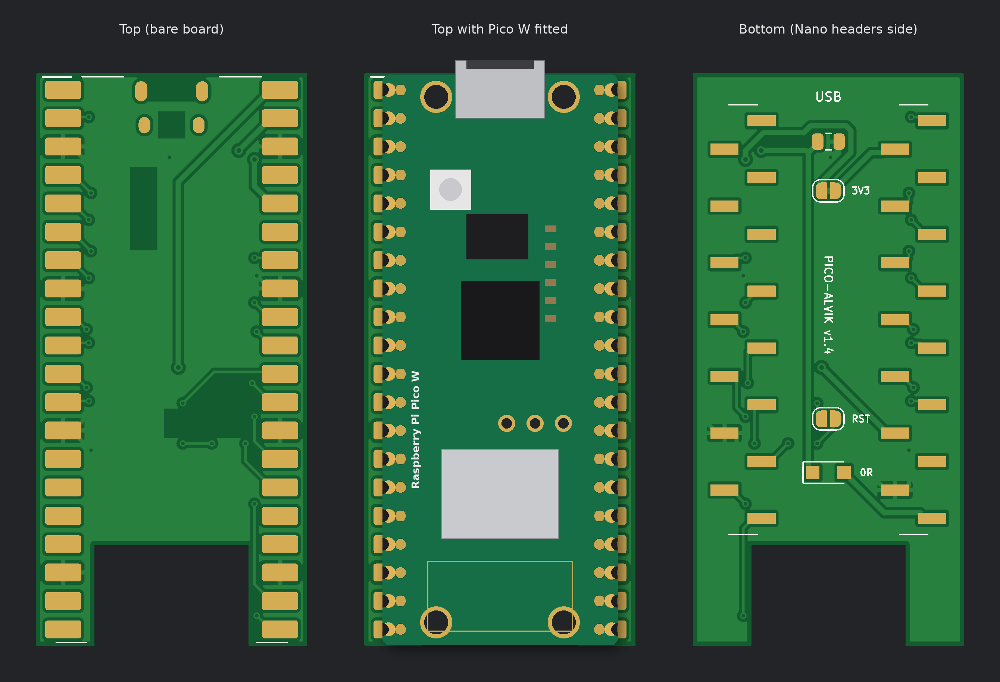

# Pico Alvik Adapter

Adapter board that lets a **Raspberry Pi Pico W** replace the **Arduino Nano ESP32**
as the main controller of the **Arduino Alvik** robot (AKX00066).

* The Pico W is soldered **flat on the top side by its castellated edge pads**,
  with no pin headers between the boards.
* The bottom side carries two **1x15 2.54 mm SMD male headers in the Arduino Nano
  footprint**. They plug into the Alvik's Nano socket in place of the Nano ESP32.
* Every Nano pin the Alvik uses (UART, BOOT0, NRST, NANO_CHK, ROBOT_CHK, I2C,
  VIN, 3V3, GND) goes to a matching Pico pin: UART0 for the STM32 link and I2C1
  for the I2C bus. Nine spare Nano pins are wired as well.
* The micro-USB connector of the Pico sits at the same end as the Nano's USB-C,
  so it stays reachable through the Alvik's rear opening.

Designed in KiCad (files saved in KiCad 7 format; they open in KiCad 7, 8 and 9).



| | |
|---|---|
| Board size | 24.0 x 51.0 mm, 2 layers, 1.6 mm FR4 |
| Pico W | 21 x 51 mm module, top side, castellated SMD |
| Nano headers | 2x 1x15 2.54 mm SMD male, bottom side, rows 15.24 mm apart |
| Antenna | 14 x 9 mm board notch under the Pico W antenna (datasheet keep-out) |

## Project layout

```
Pico_Alvik_Adapter.kicad_pro / .kicad_sch / .kicad_pcb   KiCad project
PicoAlvik.kicad_sym, PicoAlvik.pretty/                   project-local symbols & footprints
sym-lib-table, fp-lib-table                              library tables (use ${KIPRJMOD})
tools/                                                   generator scripts (design.py is the single source of truth)
firmware/pinout_definitions_pico.py                      Alvik MicroPython pin map for the Pico W
fabrication/                                             gerbers, drill, BOM, position file, PDFs, renders
Materials/                                               datasheets / pinouts / schematics used for the design
```

## Pin mapping

Nano header pin numbers use the classic Nano numbering (1 = D1/TX ... 30 = VIN).

**Pins used by the Alvik** (from Arduino's `arduino-alvik-mpy` library, `pinout_definitions.py` and `uart.py`, plus the
Alvik datasheet block diagram; copies in `Materials/extracted/`):

| Nano pin | J1 | Pico GPIO | U1 pin | Alvik function | Pico peripheral |
|---|---|---|---|---|---|
| D1/TX1 | 1 | GP16 | 21 | UART TX -> STM32 RX (460800 baud) | UART0 TX |
| D0/RX0 | 2 | GP17 | 22 | UART RX <- STM32 TX | UART0 RX |
| D2 | 5 | GP20 | 26 | STM32 BOOT0 | |
| D3 | 6 | GP21 | 27 | STM32 NRST | |
| D4 | 7 | GP22 | 29 | NANO_CHK (EXT_CHK) | |
| A4/SDA | 23 | GP6 | 9 | I2C SDA (Qwiic / Grove, BMS, IMU...) | I2C1 SDA |
| A5/SCL | 24 | GP7 | 10 | I2C SCL | I2C1 SCL |
| A6 | 25 | GP8 | 11 | ROBOT_CHK (input) | |
| 3V3 | 17 | 3V3(OUT) | 36 | +3V3_EXT supply of the Alvik | via JP2 (bridged) |
| VBUS/VUSB | 27 | VBUS | 40 | USB 5V to the Alvik (power / battery charging) | direct |
| VIN | 30 | VSYS | 39 | Alvik powers the controller (and sees USB via the Pico diode, as with a Nano) | D1 = 0 Ω (opt. Schottky) |
| GND | 4, 29 | GND | 3,8,13,18,23,28,33,38 | | |
| RST | 3 | RUN | 30 | (not used by the Alvik) | via JP3 (open) |

**Spare Nano pins** (the Alvik leaves these unconnected). The ones that route cleanly are wired anyway:

| Nano pin | J1 | Pico GPIO | U1 pin | Note |
|---|---|---|---|---|
| D5 | 8 | GP26 | 31 | ADC0 |
| D6 | 9 | GP27 | 32 | ADC1 |
| D7 | 10 | GP28 | 34 | ADC2 |
| D13 | 16 | GP1 | 2 | |
| A0 | 19 | GP2 | 4 | |
| A1 | 20 | GP3 | 5 | |
| A2 | 21 | GP4 | 6 | |
| A3 | 22 | GP5 | 7 | |
| A7 | 26 | GP9 | 12 | |

Not connected: Nano D8–D12, B0, B1. Pico GP0, GP10–GP15, GP18, GP19,
ADC_VREF and 3V3_EN.

Each group is assigned in the same order on both sides, so its tracks never cross. The Nano-side
order is kept on the Pico's right edge (TX/RX/D2–D4) and left edge (A4–A6).

## Power design

From the Nano ESP32 schematic (`Materials/Arduino_Nano_ESP32_ABX00083_schematics.pdf`; crops in
`Materials/extracted/`):

* The USB-C VBUS pins go straight to net `VUSB` (only the ESD array is on it). `VUSB` goes directly to
  the header's **VBUS/VUSB pin**, which is raw USB 5V.
* `VUSB -> D2 (PMEG6020AELRX, 2 A) -> VIN node -> MP2322 buck (IN, EN)`. The header's **VIN pin is
  that node itself**: there is **no diode between VIN and the regulator**.
* So a Nano on the Alvik puts USB 5V out on VUSB, and about 4.65 V out on VIN through D2. With USB
  unplugged, it takes its power from the Alvik through VIN. The Alvik must therefore tolerate VIN being
  driven from the controller side.

The Pico W has the same structure (`VBUS -> on-board Schottky -> VSYS -> buck-boost`), so the adapter
reproduces the Nano exactly:

| Nano ESP32 | Adapter (D1 = 0 Ω, default) |
|---|---|
| USB VBUS -> VUSB header pin, direct | Pico VBUS -> Nano VBUS/VUSB pin (27), direct |
| VUSB -> PMEG6020 (2 A) -> VIN node -> regulator | VBUS -> Pico on-board Schottky (MBR120, 1 A) -> VSYS |
| VIN pin = regulator input (no diode) | Nano VIN (30) -> **D1 = 0 Ω** -> VSYS |

* **D1 default: 1206 0 Ω**, on SOD-123W pads (a 1206 resistor fits them). This behaves like a Nano:
  USB reaches the Alvik on both VUSB and VIN, and the Alvik powers the Pico through VIN when USB is
  unplugged.
* **Option: fit a Nexperia PMEG6020ER** (anode = VIN) instead. The Alvik can still power the Pico, but
  Pico USB power no longer goes out on VIN. Only do this if you find the Alvik must not see USB on VIN.
  A Nano does drive it, so this shouldn't be necessary.
* **Current limit:** the Pico's VBUS->VSYS diode is rated 1 A, against 2 A on the Nano. If the Alvik
  draws its charge current through VIN, that diode carries it together with the Pico's own load.
* **VSYS range is 1.8–5.5 V.** The Alvik VIN (5 V boost rail or the 3.0–4.2 V cell) is inside it.
* **JP2 (bridged):** Pico 3V3(OUT) -> Nano 3V3 pin. On the Nano, 3V3 is the output of its MP2322
  (through SJ1), and on the Alvik it feeds `+3V3_EXT` (the I2C switch supply). Keep the 3V3 load under
  300 mA. If you ever measure about 3.3 V on the Alvik's 3V3 socket pin with no controller fitted,
  cut JP2.
* **JP3 (open):** optional, Nano RST -> Pico RUN.
* C1: 10 µF on VSYS.

**Bring-up check:** with the adapter removed and the Alvik switched on, measure the Alvik's Nano socket.
VIN (pin 30) should be ≤ 5.5 V. VBUS (pin 27) and 3V3 (pin 17) should be about 0 V.

## Mechanical notes

* The SMD headers keep the top copper flat under the Pico W, because Nano rows (15.24 mm) and
  Pico rows (17.78 mm) overlap and through-hole joints would short against the Pico's pins.
* Copper is kept out from under the Pico W test points TP1–TP6 and the SWD pads (datasheet §2.2).
  Vias are tented.
* The board is 24 mm wide (Nano: 18 mm). Check the clearance inside the Alvik's
  top cover before ordering.
* Bottom-side parts (C1, D1, jumpers) sit between the header rows and are at most about 1.2 mm high.
* Use male headers with a standard 2.54 mm pin (about 6 mm mating length). Recommended stack:
  SMD header, e.g. Samtec TSM-115-01-x-SV or any generic 1x15 SMD 2.54 mm male header.

## Firmware

`firmware/pinout_definitions_pico.py` is a Pico W version of the Alvik library's
`pinout_definitions.py`. It also lists the other changes the RP2040 port needs:
UART0 on GP16/GP17, I2C1 on GP6/GP7, and a single LED instead of an RGB LED.

## Regenerating the design

The schematic, libraries and PCB are produced by the scripts in `tools/`
from `tools/design.py`:

```sh
cd tools
python3 gen_libs.py                 # PicoAlvik.kicad_sym + PicoAlvik.pretty
python3 gen_schematic.py            # Pico_Alvik_Adapter.kicad_sch
kicad-cli sch export netlist -o ../build/net.net ../Pico_Alvik_Adapter.kicad_sch
python3 check_netlist.py ../build/net.net     # schematic == design.py ?
/usr/bin/python3 gen_pcb.py place   # placement, outline, keep-outs (+ .dsn for Freerouting)
/usr/bin/python3 gen_pcb.py geom    # geometry for the router
python3 router.py                   # 2-layer A* grid router -> build/routes.json
/usr/bin/python3 gen_pcb.py finish  # import routes, GND pours, zone fill, DRC report
bash export_fab.sh                  # gerbers, drill, BOM, PDFs
python3 render_board.py             # fabrication/docs/Pico_Alvik_Adapter_render.png
```

Status of the checked-in board: all nets routed, **KiCad DRC: 0 violations, 0 unconnected
pads** (`build/` is regenerated and not committed). KiCad 7's command line has no ERC, so the
schematic is verified with `check_netlist.py`, which compares KiCad's exported netlist to `design.py`.
Running ERC once in the KiCad GUI is still worthwhile.

`gen_pcb.py place` also writes `build/Pico_Alvik_Adapter.dsn`. If you prefer Freerouting,
route that file, save the `.ses` as `build/Pico_Alvik_Adapter.ses`, delete
`build/routes.json`, and run `gen_pcb.py finish`.
